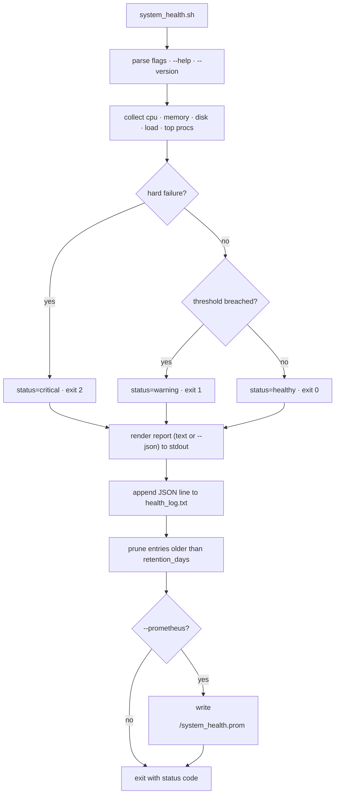

# CareGuide `system_health_app` — Bash System Health Monitor

## Context

`system_health_app/Prompt.md` asks for a **bash** Linux automation script:

1. `system_health.sh` collecting CPU usage, memory usage, disk usage (all mounted filesystems), load average, and the top 5 processes by memory.
2. Append a timestamped entry to `health_log.txt`, with a `--json` output option and a 3-day retention period.
3. Configurable thresholds via flags (`--disk 80 --cpu 90 --mem 85`) with sensible defaults, printing `[WARNING]` messages when exceeded.
4. Meaningful exit codes: `0` = healthy, `1` = warning, `2` = critical, for Prometheus-style monitoring.
5. `set -euo pipefail`, shellcheck with no warnings, and a `--help` option.
6. A cron entry or a systemd service + timer running every 5 minutes.

### Repository state (verified by read)

- `system_health_app/` holds **only**: `Prompt.md` (the 8-line brief), an **empty** `Dockerfile`, an **empty** `.dockerignore`, an **empty** `ci.yml`, and a Django-generated `.gitignore`.
- The sibling `app/` tree already contains a **finished** FastAPI service (different task, different language) — **untouched** by this plan.
- Root `ci.yml`, `docker-compose.yml`, `docker-compose.monitoring.yml`, `IaC/run.sh`, `k8s/Chart.yaml` are empty placeholders — **untouched**.
- No `.github/` directory exists anywhere in the repo.
- Remote: `https://github.com/Mostafizur0/CareGuide-Assessment.git`, branch `feature/app`.

## Confirmed decisions (from clarification)

| Area | Decision |
|---|---|
| Scope | Core script + cron/systemd units + README + CI. **No** tests directory, **no** Dockerfile (the `system_health_app/Dockerfile` and `.dockerignore` placeholders stay empty) |
| Log format | `health_log.txt` is **always JSON-lines**; `--json` only changes **stdout** to a JSON report |
| Severity | Exit `2` (critical) **only** on hard failures — a filesystem at 100 % or zero available memory. Every threshold breach is exit `1` (warning) |
| CI placement | Real workflow at `.github/workflows/system-health.yml` (Actions only auto-detects the repo-root `.github/workflows/`) |
| Prometheus | Extra `--prometheus` mode writing node_exporter textfile `.prom` metrics |

## Target file layout

```
system_health_app/
├── Prompt.md                     # unchanged (the brief)
├── .gitignore                    # appended: health_log.txt, *.prom
├── README.md                     # new: usage, exit codes, JSON schema, metrics, install steps
├── system_health.sh              # new: the monitor (executable, +x)
├── fixtures/proc/{healthy,warning,critical}/   # new: fake /proc trees for CI
│   ├── stat
│   ├── meminfo
│   └── loadavg
├── cron/system-health.cron       # new: /etc/cron.d snippet (every 5 minutes)
└── systemd/
    ├── system-health.service     # new: Type=oneshot
    └── system-health.timer       # new: OnUnitActiveSec=5min
.github/workflows/system-health.yml  # new: shellcheck + functional smoke tests
```

Install target on a host: `/opt/system_health/system_health.sh`, log at `/var/log/system_health/health_log.txt`.

## CLI contract

| Flag | Default | Purpose |
|---|---|---|
| `--cpu <pct>` | `90` | CPU usage warning threshold (%) |
| `--mem <pct>` | `85` | Memory usage warning threshold (%) |
| `--disk <pct>` | `80` | Per-filesystem warning threshold (%) |
| `--json` | off | Print the report to stdout as one JSON object (log file stays JSON-lines either way) |
| `--prometheus` | off | Write node_exporter textfile metrics (implies `--prometheus-dir`) |
| `--prometheus-dir <dir>` | `/var/lib/node_exporter/textfile_collector` | Destination for the `.prom` file |
| `--log-file <path>` | `health_log.txt` | Append target for the JSON-lines log |
| `--retention-days <n>` | `3` | Delete log entries older than n days |
| `--top <n>` | `5` | How many top processes by memory to report |
| `--exclude-fs <list>` | pseudo-fs set | Comma-separated fstypes to skip from the disk report |
| `--proc-root <dir>` | `/proc` | Read `stat`/`meminfo`/`loadavg` from an alternative root — **the deterministic testing seam used by CI** |
| `--cpu-interval <s>` | `1` | Seconds between the two `/proc/stat` samples |
| `--help`, `-h` | — | Usage text, exit `0` |
| `--version` | — | Script version, exit `0` |

Thresholds also read from `SYSTEM_HEALTH_CPU_THRESHOLD`, `SYSTEM_HEALTH_MEM_THRESHOLD`, `SYSTEM_HEALTH_DISK_THRESHOLD`; the flag always wins. `LC_ALL=C` is exported so decimal points and sort order are stable.

**Unknown flag → usage on stderr and exit `2`** (invalid invocation, not a health state).

## Exit codes

| Code | Meaning | Condition |
|---|---|---|
| `0` | healthy | No threshold breached, no hard failure |
| `1` | warning | CPU ≥ `--cpu`, memory ≥ `--mem`, or any filesystem ≥ `--disk` |
| `2` | critical | Hard failure only: a filesystem at 100 % usage, or zero available memory. Takes precedence over warnings |

## Collectors

| Metric | Source | Notes |
|---|---|---|
| CPU usage % | `/proc/stat` aggregate `cpu` line, two samples `--cpu-interval` apart | `usage = 100 * (1 - idle_delta/total_delta)`. If the counters do not advance (delta `0`), usage is `0.0` — no division by zero. Fallback to `vmstat 1 2` when `/proc/stat` is unreadable |
| Memory | `/proc/meminfo` | `MemTotal`, `MemAvailable` (fallback `MemFree+Buffers+Cached`), `SwapTotal`/`SwapFree` reported but not thresholded |
| Disk | `df -P -T` | All mounted filesystems except the pseudo-fs set (`tmpfs`, `devtmpfs`, `proc`, `sysfs`, `cgroup`, `cgroup2`, `devpts`, `squashfs`, `overlay` kept on purpose) |
| Load average | `/proc/loadavg` | 1/5/15-minute values plus `nproc` for per-core normalisation |
| Top processes | `ps -eo pid=,comm=,rss=,%mem= --sort=-rss` | Top `--top` by RSS |

## Output contract

**stdout** — text report (default) or one JSON object (`--json`). **stderr** — one `[WARNING] …` / `[CRITICAL] …` line per finding, nothing else. The JSON payload carries the same findings in `warnings` / `criticals` arrays.

### JSON-lines log entry (`health_log.txt`) and `--json` payload

```json
{"timestamp":"2026-11-11T14:32:43Z","epoch":1794417163,"hostname":"node-01","status":"warning",
 "exit_code":1,
 "cpu":{"usage_percent":93.2,"threshold_percent":90,"exceeded":true},
 "memory":{"total_bytes":16384000000,"available_bytes":1048576000,"usage_percent":93.6,"threshold_percent":85,"exceeded":true,
           "swap_total_bytes":0,"swap_used_bytes":0},
 "load_average":{"1m":0.52,"5m":0.41,"15m":0.33,"cores":4},
 "disks":[{"mountpoint":"/","fstype":"ext4","size_bytes":107374182400,"used_bytes":45000000000,
           "available_bytes":62374154240,"usage_percent":42.0,"threshold_percent":80,"exceeded":false}],
 "top_processes_by_memory":[{"pid":1234,"command":"postgres","rss_bytes":126353408,"mem_percent":7.7}],
 "warnings":["[WARNING] Memory usage 93.6% exceeds threshold 85%"],"criticals":[]}
```

`health_log.txt` holds **one such object per line**. JSON is emitted by a hand-rolled writer with a `json_escape` helper (backslashes, quotes, tabs, CR, LF) — **no `jq` dependency**.

### Retention

After appending, lines whose `epoch` is older than `now - retention_days * 86400` are dropped. The rewrite goes to a temp file in the same directory and is moved into place with `mv -f` (atomic, no truncated log for readers). The log directory is created with `mkdir -p` when missing.

### Prometheus textfile metrics (`--prometheus`)

Written atomically to `<dir>/system_health.prom` (temp file + `mv`):

```
# HELP system_health_cpu_usage_percent Current CPU usage percentage.
# TYPE system_health_cpu_usage_percent gauge
system_health_cpu_usage_percent 12.30
# TYPE system_health_memory_usage_percent gauge
system_health_memory_usage_percent 44.10
# TYPE system_health_load_average gauge
system_health_load_average{interval="1m"} 0.52
# TYPE system_health_disk_usage_percent gauge
system_health_disk_usage_percent{mountpoint="/",fstype="ext4"} 42.10
# TYPE system_health_disk_size_bytes gauge
system_health_disk_size_bytes{mountpoint="/"} 107374182400
# TYPE system_health_disk_free_bytes gauge
system_health_disk_free_bytes{mountpoint="/"} 62374154240
# TYPE system_health_process_resident_memory_bytes gauge
system_health_process_resident_memory_bytes{process="postgres"} 126353408
# TYPE system_health_status gauge
system_health_status 0
```

`system_health_status` = `0` healthy, `1` warning, `2` critical — the direct Prometheus counterpart of the exit code. Label values are escaped with the same `json_escape` helper.

## Script flow



## Task details

### T1 — `system_health.sh`: CLI, help and collectors
**File:** `system_health_app/system_health.sh`
`#!/usr/bin/env bash`, `set -euo pipefail`, `LC_ALL=C`. `usage()` prints the flag table above to stdout (`--help`) or stderr (invalid invocation). Manual flag loop — no `getopts`, so long flags work. Numeric arguments validated as integers in `1..100`; anything else → usage on stderr, exit `2`.
Collectors implement the table above. CPU: two `/proc/stat` reads with `--cpu-interval` sleep; `total_delta == 0` → `0.0`. Memory from `meminfo`. Disk from `df -P -T`, skipping the header row and excluded fstypes. Load from `loadavg`. Top processes from `ps`.
**Acceptance:** `--help` exits `0` and lists every flag; `--version` exits `0`; an unknown flag exits `2` with usage on stderr; the script runs on the host without error and prints a report.

### T2 — Threshold evaluation, messages and exit codes
**File:** `system_health.sh` (evaluation section)
Evaluate in this order: hard failure (disk usage ≥ 100 % **or** memory available bytes = 0) → `critical`, exit `2`; else any CPU/memory/disk threshold breach → `warning`, exit `1`; else `healthy`, exit `0`. Warnings/criticals are collected into arrays and printed to stderr as `[WARNING] …` / `[CRITICAL] …` lines.
**Acceptance:** the three fixture scenarios produce exit `0`, `1` and `2` respectively; a hard failure reports `2` even when a threshold is also breached.

### T3 — JSON-lines log with retention
**File:** `system_health.sh` (logging section)
Build the entry with `json_escape` + `printf`, append one line to `--log-file` (`mkdir -p` the parent first). Retention prune: compare each line's `epoch` field against the cutoff with `awk`, write the survivors to a temp file in the same directory, `mv -f` into place.
**Acceptance:** two consecutive runs append two valid JSON lines; a hand-written line with a stale `epoch` disappears after a run with `--retention-days 1`; the log file is never left truncated.

### T4 — `--json` stdout report
**File:** `system_health.sh` (rendering section)
`--json` prints exactly one JSON object on stdout (same schema as the log entry). Without it, stdout carries the human-readable report (CPU, memory, load, per-filesystem disk table, top processes). Warnings always go to stderr in both modes.
**Acceptance:** `--json` output parses with `jq`/`python3 -m json.tool`; the default output contains the filesystem table and the process list.

### T5 — `--prometheus` textfile writer
**File:** `system_health.sh` (prometheus section)
Write the metrics listed above to `<dir>/system_health.prom` via temp file + `mv -f`; create the directory if missing; fail with a clear stderr message and exit `2` if the directory cannot be created.
**Acceptance:** the file contains the `# HELP`/`# TYPE` pairs and the metric families above; re-running never leaves a partially written file.

### T6 — Scheduling units and ignore rules
**Files:** `system_health_app/cron/system-health.cron`, `system_health_app/systemd/system-health.service`, `system_health_app/systemd/system-health.timer`, `system_health_app/.gitignore`
- cron: `/etc/cron.d/system-health` snippet, `*/5 * * * * root /opt/system_health/system_health.sh --log-file /var/log/system_health/health_log.txt --prometheus >> /var/log/system_health/cron.log 2>&1`.
- service: `Type=oneshot`, `ExecStart=/opt/system_health/system_health.sh --log-file …`, `SuccessExitStatus=1` so a warning exit does not mark the unit failed, `Nice=10`, `IOSchedulingClass=idle`.
- timer: `OnBootSec=1min`, `OnUnitActiveSec=5min`, `Persistent=true`, `RandomizedDelaySec=30`, `Unit=system-health.service`.
- `.gitignore`: append `health_log.txt`, `*.prom`.
**Acceptance:** the timer fires every 5 minutes; the service unit reports success for exit `1`.

### T7 — Fixtures and GitHub Actions workflow
**Files:** `system_health_app/fixtures/proc/{healthy,warning,critical}/{stat,meminfo,loadavg}`, `.github/workflows/system-health.yml`
Fixtures: `stat` with one aggregate `cpu` line; `meminfo` with `MemTotal: 16000000 kB` and `MemAvailable` `8000000` (healthy) / `1000000` (warning) / `0` (critical); `loadavg` `0.52 0.41 0.33 1/234 5678`.
Workflow (on `push`/`pull_request` touching `system_health_app/**`): checkout → `bash -n system_health.sh` → `shellcheck --severity=style system_health.sh` (must exit `0`) → functional smoke tests: `--help` exits `0`; the three fixture scenarios exit `0`/`1`/`2`; `--json` stdout parses with `jq -e .`; stderr contains `[WARNING]` in the warning run and `[CRITICAL]` in the critical run; the log file grows by one valid JSON line per run; a stale line is pruned with `--retention-days 1`; `--prometheus` writes a file containing `system_health_cpu_usage_percent` and `system_health_status`. `jq` is preinstalled on `ubuntu-latest`.
**Acceptance:** the workflow runs green on a push; every assertion above holds.

### T8 — README
**File:** `system_health_app/README.md`
Purpose, requirements (`bash` 4+, coreutils, procps), the flag table, exit codes, the JSON schema, the Prometheus metric reference and the node_exporter textfile-collector wiring, cron and systemd install steps (including `chmod +x` and the `SuccessExitStatus=1` rationale), retention behaviour, environment-variable overrides, and the CI workflow description. Root `README.md` stays untouched.
**Acceptance:** every command in the document is copy-pasteable and matches the implemented flags.

### T9 — Verification
Run locally: `bash -n` → `shellcheck --severity=style` (zero findings) → the three fixture scenarios → `--json` parse → retention prune → `--prometheus` output → `--help` → file mode `0755` (`chmod +x`; `git update-index --chmod=+x` if needed).

## Out of scope

The empty `system_health_app/Dockerfile` and `.dockerignore` placeholders, the empty `system_health_app/ci.yml`, the finished `app/` FastAPI tree, the monitoring stack, the Helm chart, `IaC/run.sh`, and the root `ci.yml`. Say the word and any of these can be planned as a follow-up.

## Verification

1. `bash -n system_health_app/system_health.sh` → syntax OK.
2. `shellcheck --severity=style system_health_app/system_health.sh` → no output, exit `0`.
3. `system_health_app/system_health.sh --help` → usage, exit `0`.
4. `--proc-root fixtures/proc/healthy` → exit `0`, empty stderr.
5. `--proc-root fixtures/proc/warning` → exit `1`, stderr contains `[WARNING]`.
6. `--proc-root fixtures/proc/critical` → exit `2`, stderr contains `[CRITICAL]`.
7. `--json` output parses as a single JSON object.
8. `health_log.txt` gains one JSON line per run; a stale-epoch line is removed with `--retention-days 1`.
9. `--prometheus --prometheus-dir /tmp/prom` writes `system_health.prom` with the expected metric families.
10. GitHub Actions workflow runs green on `system_health_app/**` changes.
