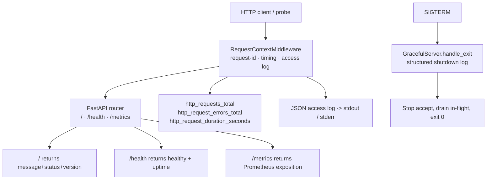

# CareGuide System Health App — Implementation Plan

## Context

`app/Prompt.md` asks for a Python FastAPI web app with:

1. `GET /` → `{"message": "Hello from DevOps Task!", "status": "running", "version": "<app version>"}`
2. `GET /health` → liveness check
3. `GET /metrics` → Prometheus format: request count, error count, request latency histogram
4. Unit tests for `/` and `/health`
5. Structured (JSON) logs per endpoint to stdout/stderr, graceful shutdown on SIGTERM (Loki + Grafana Alloy consumers)
6. Multi-stage minimal-size Dockerfile, pinned base image, non-root user, `HEALTHCHECK` on `/health`, OCI labels, `.dockerignore`

Current repo state (verified by read): `app/` contains only `Prompt.md` and three **empty** placeholders (`Dockerfile`, `.dockerignore`, `ci.yml`). No Python source, no dependency manifests, no tests. Sibling `system_health_app/`, `k8s/Chart.yaml`, `IaC/run.sh`, `docker-compose.yml`, `docker-compose.monitoring.yml` and root `ci.yml` are **also empty** and stay untouched — scope confirmed as **app/ only**.

Remote (from `.git/config`): `https://github.com/Mostafizur0/CareGuide-Assessment.git`, branch `feature/app`.

## Confirmed decisions

| Area | Decision |
|---|---|
| Scope | `app/` only — no monitoring stack, no Helm chart, no CI pipeline (deferred, see *Out of scope*) |
| Runtime | `python:3.13-alpine3.21` + `uv` (pinned `ghcr.io/astral-sh/uv` tag) |
| Metrics | `prometheus-client` |
| Logging | `python-json-logger` (stdlib `logging`, JSON formatter) |

## Target file layout (all under `app/`)

```
app/
├── Dockerfile                     # multi-stage, pinned, non-root, HEALTHCHECK, OCI labels
├── .dockerignore
├── requirements.txt               # pinned runtime deps
├── requirements-dev.txt           # pinned test deps (-r requirements.txt)
├── pyproject.toml                 # pytest config only (no build backend needed)
├── README.md                      # run / test / build / config reference
├── src/system_health/
│   ├── __init__.py                # __version__ = "1.0.0"
│   ├── config.py                  # env-driven settings
│   ├── logging_config.py          # JSON formatter + stdout/stderr split
│   ├── metrics.py                 # counters, histogram, /metrics exposition
│   ├── middleware.py              # request-id, access log, metrics instrumentation
│   └── main.py                    # app factory, routes, lifespan, uvicorn runner
└── tests/
    ├── conftest.py                # TestClient fixtures
    ├── test_root.py
    ├── test_health.py
    └── test_metrics.py            # extra smoke test beyond the required two
```

`src/` layout keeps the import path clean (`system_health.*`); the image sets `PYTHONPATH=/app/src` so no packaging/build-backend step is required.

## Pinned dependencies

| File | Contents | Rationale |
|---|---|---|
| `requirements.txt` | `fastapi==0.115.6`, `uvicorn==0.34.0`, `prometheus-client==0.21.1`, `python-json-logger==2.9.0` | `uvicorn` **without** `[standard]` extras: `uvloop`/`httptools` ship no musl wheels, so `[standard]` would force a source build on Alpine |
| `requirements-dev.txt` | `-r requirements.txt`, `pytest==8.3.4`, `httpx==0.28.1` | `httpx` is required by Starlette's `TestClient` |
| `pyproject.toml` | `[tool.pytest.ini_options]` only: `pythonpath = ["src"]`, `testpaths = ["tests"]` | keeps `uv pip install -r` free of any build backend |

**Build-risk fallback (documented in `app/README.md`):** if a pinned wheel is missing for cp313/musl (e.g. `pydantic-core`), the builder stage adds `RUN apk add --no-cache build-base` — the runtime stage stays clean — or the base tag falls back to `python:3.12-alpine3.21`. Confirm the base tag and `uv` tag resolve during T7.

## Behaviour specification

**`GET /`** → HTTP 200, `application/json`

```json
{"message": "Hello from DevOps Task!", "status": "running", "version": "1.0.0"}
```

`version` comes from `APP_VERSION` (default `1.0.0`), also used by the OCI `org.opencontainers.image.version` label.

**`GET /health`** → HTTP 200, `application/json` — liveness only (no dependency checks), body `{"status": "healthy", "version": "1.0.0", "uptime_seconds": 12.34}`.

**`GET /metrics`** → HTTP 200, `text/plain; version=0.0.4; charset=utf-8` (Prometheus content type), body from `prometheus_client.generate_latest()` including the default process/platform collectors:

| Metric | Type | Labels | Increments when |
|---|---|---|---|
| `http_requests_total` | Counter | `method`, `route`, `status_code` | every request (route template, not raw path, to bound cardinality) |
| `http_request_errors_total` | Counter | `method`, `route`, `status_code` | response status ≥ 400 |
| `http_request_duration_seconds` | Histogram | `method`, `route` | every request (buckets: 0.005 → 10 s) |

`/metrics` requests are **excluded** from the counters/histogram to avoid self-inflation.

**Structured logs** — one JSON object per line via `pythonjsonlogger.jsonlogger.JsonFormatter`:

```json
{"timestamp":"2025-01-01T12:00:00.000000Z","level":"INFO","logger":"system_health.access",
 "message":"request completed","request_id":"3f2b...","method":"GET","route":"/","path":"/",
 "status_code":200,"duration_ms":3.12,"client_ip":"10.0.0.5","user_agent":"curl/8.4.0","app_version":"1.0.0"}
```

- Stream split: `INFO`/below → **stdout**; `WARNING`/`ERROR` → **stderr** (Loki/Grafana Alloy friendly).
- Startup/shutdown events logged at `INFO` with `event: startup|shutdown`; unhandled exceptions logged at `ERROR` with `error_type`, `error_message`, `traceback`.
- `uvicorn` is started with `log_config=None` and `access_log=False` so its plaintext handlers never bypass the JSON formatter and no duplicate access lines are emitted.
- Incoming `X-Request-ID` is honoured, otherwise a UUID4 is generated and echoed in the response.

**Graceful shutdown on SIGTERM** — `main.py` subclasses `uvicorn.Server` and overrides `handle_exit(sig, frame)` to emit a structured `event: shutdown` log (signal name + grace period) before delegating to `super().handle_exit()`. Uvicorn then stops accepting connections and drains in-flight requests; `timeout_graceful_shutdown=30` bounds the wait. The container's `STOPSIGNAL SIGTERM` (default) therefore produces a clean exit code 0.

## Request flow



## Task details

### T1 — Scaffold package layout and pinned dependency manifests
**Files:** `app/requirements.txt`, `app/requirements-dev.txt`, `app/pyproject.toml`, `app/src/system_health/__init__.py`
Create the `src/system_health` package with `__version__ = "1.0.0"`, plus the three manifest files with the exact pins above.
**Acceptance:** all files exist, `python -c "import system_health; print(system_health.__version__)"` works with `PYTHONPATH=src`, no unpinned dependency.

### T2 — Settings and JSON structured logging
**Files:** `app/src/system_health/config.py`, `app/src/system_health/logging_config.py`
`config.py`: dataclass settings read from env — `APP_NAME` (`system-health`), `APP_VERSION` (`1.0.0`), `HOST` (`0.0.0.0`), `PORT` (`8000`), `LOG_LEVEL` (`INFO`), `LOG_FORMAT` (`json`), `METRICS_PATH` (`/metrics`), `GRACEFUL_TIMEOUT` (`30`), `REQUEST_TIMEOUT`. No extra dependency (stdlib `os`).
`logging_config.py`: `JsonFormatter` with ISO-8601 UTC timestamp, `level`, `logger`, `message` plus any `extra=` keys; stdout handler (level INFO) and stderr handler (level WARNING) on the root logger; idempotent `configure_logging()`; helper `log_event(logger, level, event, **fields)`.
**Acceptance:** `logging.getLogger("x").info("m", extra={"request_id": "abc"})` emits one valid JSON line on stdout containing `request_id`; a `WARNING` record lands on stderr.

### T3 — Prometheus metrics module
**Files:** `app/src/system_health/metrics.py`
Define the three metrics on the default `REGISTRY` (see table above), a `record_request(method, route, status_code, duration)` helper, and `render_metrics()` returning `(body_bytes, content_type)`.
**Acceptance:** `render_metrics()` output contains `http_requests_total`, `http_request_errors_total`, `http_request_duration_seconds_bucket` and `_count`; the Prometheus content type header is used by the route.

### T4 — Request context, access log and metrics middleware
**Files:** `app/src/system_health/middleware.py`
Pure-ASGI middleware (no `BaseHTTPMiddleware` overhead): generate/propagate `X-Request-ID`; time the call; resolve the route template from `scope["route"].path` with a fallback to the raw path; call `record_request(...)`; emit the structured access log; set the response header `X-Request-ID`. Skip metric recording (but keep logging) for the metrics path.
**Acceptance:** a request to `/` yields exactly one `http_requests_total` increment labelled `route="/"` and one JSON access log line with the same `request_id` as the response header; `route` label uses the template, not the query string.

### T5 — FastAPI app, endpoints, lifespan and graceful shutdown
**Files:** `app/src/system_health/main.py`
`create_app()` factory: FastAPI instance (title/version from settings), the three routes, the middleware, a `500` exception handler that logs `ERROR` with traceback and returns a JSON error body, and a lifespan context manager that logs `event: startup` (host/port/version) and `event: shutdown`.
`GracefulServer(uvicorn.Server)` overrides `handle_exit` → structured shutdown log → `super().handle_exit()`. `main()` builds `uvicorn.Config(app, host, port, log_config=None, access_log=False, timeout_graceful_shutdown=30)` and runs the server. Module-level `app = create_app()` for `TestClient` import.
**Acceptance:** `GET /` returns exactly the three specified keys with `message == "Hello from DevOps Task!"` and `status == "running"`; `GET /health` returns 200 `status == "healthy"`; `GET /metrics` returns 200 Prometheus text; `SIGTERM` produces the shutdown log line and exit code 0.

### T6 — Unit tests for `/` and `/health` (+ metrics smoke test)
**Files:** `app/tests/conftest.py`, `app/tests/test_root.py`, `app/tests/test_health.py`, `app/tests/test_metrics.py`
`conftest.py`: `client` fixture using `fastapi.testclient.TestClient` (module-level `app`), plus a `lifespan_client` fixture using `with TestClient(app)` for startup/shutdown assertions.
`test_root.py`: status 200, `content-type` JSON, exact key set, exact `message`/`status` values, `version` non-empty and matching `APP_VERSION`.
`test_health.py`: status 200, body `status == "healthy"`, `uptime_seconds` present and ≥ 0; a case asserting the health endpoint returns 200 without auth/params.
`test_metrics.py`: status 200, Prometheus content type, body contains `http_requests_total` and `http_request_duration_seconds_bucket`; a case asserting a request to `/` increments `http_requests_total` for route `/`.
**Acceptance:** `pytest` passes with 0 failures and 0 errors from `app/` with `PYTHONPATH=src`.

### T7 — Multi-stage Dockerfile with pinned base, non-root user, HEALTHCHECK, OCI labels
**Files:** `app/Dockerfile`
Three stages, all `python:3.13-alpine3.21` (base pinned by version, and via `ARG`):
- `builder` — copy `ghcr.io/astral-sh/uv:0.5.11` binary; `ENV UV_COMPILE_BYTECODE=1 UV_LINK_MODE=copy UV_PYTHON_DOWNLOADS=never`; `uv venv /opt/venv`; `uv pip install --no-cache -r requirements.txt`.
- `runtime` — copy `/opt/venv` from builder; copy `src/` with `--chown`; `RUN addgroup -S -g 10001 appgroup && adduser -S -u 10001 -G appgroup app`; `ENV PATH="/opt/venv/bin:$PATH" PYTHONPATH=/app/src PYTHONUNBUFFERED=1 PYTHONDONTWRITEBYTECODE=1`; `USER app:app`; `EXPOSE 8000`; `STOPSIGNAL SIGTERM`; OCI labels (`title`, `description`, `version` from `ARG APP_VERSION`, `source` = the GitHub repo URL, `revision` from `ARG VCS_REF`, `created` from `ARG BUILD_DATE`, `base.name`); `HEALTHCHECK --interval=30s --timeout=5s --start-period=10s --retries=3` hitting `http://127.0.0.1:8000/health` using the venv Python (no extra package → no image bloat); `ENTRYPOINT ["/opt/venv/bin/python", "-m", "system_health.main"]`.
No `pip`, no compilers, no cache files in the final image; tests and `.git` excluded via `.dockerignore`.
**Acceptance:** `docker build` succeeds; `docker inspect` shows `User` = non-root uid, `Healthcheck` present, and the OCI labels; image size target < 120 MB; container runs as non-root and reports `healthy`.

### T8 — `.dockerignore`
**Files:** `app/.dockerignore`
Exclude `.git`, `.github`, `.venv`, `venv`, `__pycache__`, `*.py[cod]`, `.pytest_cache`, `.mypy_cache`, `.ruff_cache`, `tests`, `htmlcov`, `.coverage`, `*.egg-info`, `.env`, `.env.*`, `README.md`, `ci.yml`, `Dockerfile`, `.dockerignore`, editor/OS cruft. Keep `src/`, `requirements.txt`, `requirements-dev.txt`, `pyproject.toml`.
**Acceptance:** `docker build` context contains no `tests/` or `.git/`; the built image has no `.pyc` files at runtime (`PYTHONDONTWRITEBYTECODE=1`).

### T9 — Document the run / test / build workflow
**Files:** `app/README.md`
Purpose, endpoint reference with sample responses, env-var table, local run (`uvicorn system_health.main` / `python -m system_health.main`), test command (`pytest`), image build and run commands with the `--build-arg` values (`APP_VERSION`, `VCS_REF`, `BUILD_DATE`), the SIGTERM/logging contract for Loki + Grafana Alloy (stdout = info, stderr = warn/error, JSON lines), the `/metrics` metric reference, and the wheel-fallback note. Root `README.md` is left untouched.
**Acceptance:** every command in the document is copy-pasteable and matches the implemented entrypoints.

### T10 — Verification pass
Execute, in this order: `pytest` in `app/` → `docker build` → run the container → `curl` `/`, `/health`, `/metrics` → `docker stop`/SIGTERM → confirm the structured shutdown log and exit code 0 → check `docker inspect` for non-root user + healthcheck + labels. Fix anything that fails before reporting.

## Out of scope (explicitly deferred, placeholders stay empty)

Monitoring stack (Loki, Grafana Alloy, Prometheus, Grafana) wiring into `docker-compose.monitoring.yml`; the `k8s/` Helm chart; `IaC/run.sh`; the GitHub Actions pipelines (`app/ci.yml`, root `ci.yml`); the duplicate `system_health_app/` tree. Say the word and any of these can be planned as a follow-up.

## Verification

**Load check** — the app and its image run and every endpoint renders as specified:

1. `cd app && pytest -q` → all tests pass, 0 failures.
2. `docker build -t careguide/system-health:1.0.0 --build-arg APP_VERSION=1.0.0 --build-arg VCS_REF=<sha> --build-arg BUILD_DATE=<rfc3339> app/` → build succeeds.
3. `docker run -d -p 8000:8000 careguide/system-health:1.0.0` → container starts, `docker inspect` shows a non-root `User`, the `/health` HEALTHCHECK, and the OCI labels; image size < 120 MB.
4. `curl -i localhost:8000/` → 200 with exactly `{"message": "Hello from DevOps Task!", "status": "running", "version": "1.0.0"}`.
5. `curl -i localhost:8000/health` → 200 with `{"status": "healthy", ...}`.
6. `curl -i localhost:8000/metrics` → 200 Prometheus text containing `http_requests_total`, `http_request_errors_total`, `http_request_duration_seconds_bucket`.
7. Container logs → one JSON object per line; an access-log line for each request; `event: shutdown` line after `docker stop` (SIGTERM) with exit code 0.
8. `docker inspect --format '{{.State.Health.Status}}' <container>` → `healthy`.
