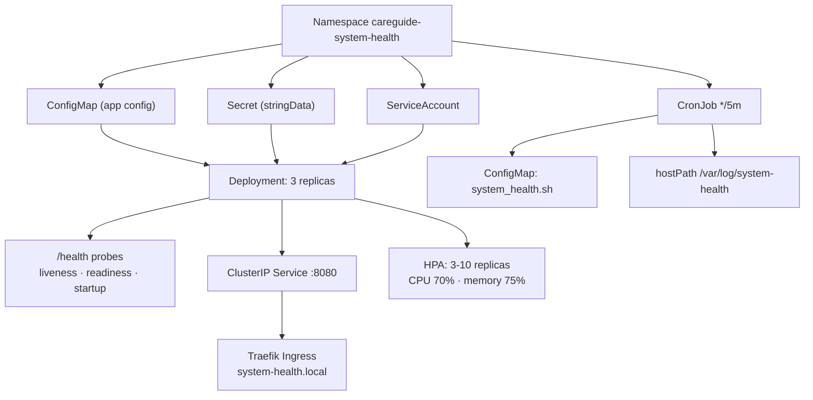

## Context

`k8s/prompt.md` asks for manifest files in `k8s/` that deploy the FastAPI app from `app/` with seven requirements:

1. Deployment with a `/health` endpoint check, production-grade `securityContext`, resource requests/limits, **replicas: 3**
2. Requests `memory: 256m`, `cpus: 0.5`; limits `memory: 600m`, `cpus: 1m`
3. Service **and** Ingress
4. ConfigMap and Secret
5. HorizontalPodAutoscaler
6. Rolling update with 25% availability, and rollback if any update fails
7. `system_health_app/scripts/system_health.sh` deployed as a CronJob in the node

The `k8s/` directory currently holds only an empty `Chart.yaml` and the prompt itself, so this is a greenfield manifest set. The Compose work in the previous session is unrelated and stays as-is.

## Confirmed decisions

| Area | Decision |
|---|---|
| CPU limit | **`limits.cpu: 1`** (1 full core). The prompt's `cpus: 1m` means 1 *millicore* — 0.001 CPU — which is below the 500m request from item 2. The API server rejects a container whose limit is lower than its request, so the literal value would make the pod unschedulable. |
| Ingress | **Traefik** (kind's default controller), host `system-health.local` |
| CronJob runtime | **`alpine:3.21`**, installing `bash` + `procps` at run time, with `hostPID: true` and a hostPath log volume on the node |
| Deliverable | Plain manifests (not a Helm chart) — `Chart.yaml` is empty and the prompt says "manifest files" |

## Repo findings that shape the work

- The app image is built from `app/` (`app/Dockerfile`): multi-stage, `python:3.13-alpine3.21`, non-root `USER app:app` with **uid/gid 10001**, `WORKDIR /app`, `PYTHONPATH=/app/src`, `STOPSIGNAL SIGTERM`, and a `HEALTHCHECK` on `http://127.0.0.1:8080/health`.
- The app serves `/`, `/health` and `/metrics` on port **8080** (`app/src/system_health/main.py`), reading config purely from the environment (`app/src/system_health/config.py`). The relevant knobs are `APP_NAME`, `APP_VERSION`, `LOG_LEVEL`, `LOG_FORMAT`, `METRICS_PATH`, `GRACEFUL_TIMEOUT`, `REQUEST_TIMEOUT`, `HOST`, `PORT`.
- Every env var has a working default, so the ConfigMap carries **non-secret** settings only.
- `.github/workflows/release.yml` publishes to `ghcr.io/${GITHUB_REPOSITORY,,}` with tags `sha-<full sha>` and semver tags. The manifests reference **`ghcr.io/mostafizur0/careguide-assessment:1.0.0`** with `imagePullPolicy: IfNotPresent`, and the tag is overridable via `kubectl set image` / a Kustomize patch.
- The image runs as uid **10001**, so `runAsNonRoot: true` + `runAsUser: 10001` align with it, and `readOnlyRootFilesystem: true` is safe — the app writes nothing to disk (logs go to stdout/stderr, which is what the Compose/Loki stack consumes).
- `system_health_app/scripts/system_health.sh` needs `bash`, `awk`, `df`, `ps`, `date`, `tee`, `wc`, `mv`, `mkdir`, and reads `/proc/meminfo`, `/proc/stat`, `/proc/loadavg`. BusyBox's `ps` has no `--sort`, so **procps** must be installed. It exits `1` on a threshold breach and `0` otherwise, and honours `HEALTH_LOG_FILE`.
- `system_health_app/` has a `fixtures/proc/` tree (healthy/warning/critical) for testing the script, but no packaged image — so the CronJob installs its runtime dependencies on start.

## Target file layout

```
k8s/
├── 00-namespace.yaml            # Namespace + ServiceAccount + ResourceQuota + LimitRange
├── 01-configmap-secret.yaml     # ConfigMap (non-secret) + Secret (stringData)
├── 02-deployment.yaml           # Deployment: 3 replicas, probes, securityContext, rolling update
├── 03-service.yaml              # ClusterIP Service (8080 -> 8080)
├── 04-ingress.yaml              # Traefik Ingress for system-health.local
├── 05-hpa.yaml                  # HorizontalPodAutoscaler (CPU + memory)
├── 06-cronjob.yaml              # CronJob running system_health.sh with hostPID
├── kustomization.yaml           # Ties the set together
└── README.md                    # Apply order, verification, rollback runbook
```

## Manifest design

### Namespace and identity

Namespace `careguide-system-health`, a dedicated ServiceAccount `system-health`, a `ResourceQuota` and a `LimitRange` that mirror the requests/limits so a stray pod cannot exhaust the namespace.

### ConfigMap and Secret

- ConfigMap `system-health-config`: `APP_NAME`, `APP_VERSION`, `LOG_LEVEL=INFO`, `LOG_FORMAT=json`, `METRICS_PATH=/metrics`, `GRACEFUL_TIMEOUT=30`, `REQUEST_TIMEOUT=30`, `HOST=0.0.0.0`, `PORT=8080`.
- Secret `system-health-secrets`: `SECRET_KEY` and `API_TOKEN` (dummy placeholder values, `type: Opaque`, `stringData`). Consumed via `envFrom`/`secretKeyRef` — never a plain env literal in the pod spec.
- **Real secrets stay out of git.** The committed Secret holds placeholders and the README documents `kubectl create secret` / `sealed-secrets` / External Secrets Operator as the production path.

### Deployment

| Setting | Value |
|---|---|
| `replicas` | `3` |
| `strategy` | `type: RollingUpdate`, `maxUnavailable: 25%`, `maxSurge: 25%` |
| `revisionHistoryLimit` | `10` (keeps rollback targets) |
| `progressDeadlineSeconds` | `600` |
| `minReadySeconds` | `10` |
| Probes | `/health` on **8080** — `livenessProbe` (delay 10, period 10, timeout 3, failureThreshold 3), `readinessProbe` (delay 5, period 5, timeout 3, failureThreshold 3), `startupProbe` (period 5, failureThreshold 30 — allows up to 150 s for a slow first start) |
| `terminationGracePeriodSeconds` | `45` (> the app's `GRACEFUL_TIMEOUT=30`) so in-flight requests drain |
| `securityContext` (pod) | `runAsNonRoot: true`, `runAsUser/runAsGroup: 10001`, `fsGroup: 10001`, `seccompProfile: {type: RuntimeDefault}` |
| `securityContext` (container) | `allowPrivilegeEscalation: false`, `readOnlyRootFilesystem: true`, `privileged: false`, `runAsNonRoot: true`, `capabilities: {drop: [ALL]}` |
| Resources | requests `memory: 256m`, `cpu: 500m`; limits `memory: 600m`, `cpu: "1"` |
| `emptyDir` | `/tmp` mounted, since `readOnlyRootFilesystem: true` otherwise blocks the Python runtime's temp use |
| `automountServiceAccountToken` | `false` — the app talks to no API server |

Three replicas need anti-affinity so they spread across nodes rather than stacking on one:

```yaml
affinity:
  podAntiAffinity:
    preferredDuringSchedulingIgnoredDuringExecution:
      - weight: 100
        podAffinityTerm:
          topologyKey: kubernetes.io/hostname
          labelSelector:
            matchLabels: {app.kubernetes.io/name: system-health}
```

### Service

`ClusterIP` Service `system-health` on port **8080** → targetPort `8080**, named `http`. (`8080`, not `80` → `8000`: the image listens on 8080 and the earlier Compose mapping `8080:8000` was a bug.) `publishNotReadyAddresses: false` so the Ingress only routes to ready pods.

### Ingress (Traefik)

`ingressClassName: traefik`, host `system-health.local`, path `/` Prefix → Service port 8080, `nginx`-style annotations omitted. Because Traefik reads the `Host` header, the README documents adding `127.0.0.1 system-health.local` to `/etc/hosts`.

### HPA

`autoscaling/v2`, `minReplicas: 3`, `maxReplicas: 10`, CPU at **70%** of the request (350m) and memory at **75%** of the request (192Mi). `behavior` sets `scaleUp` (aggressive: 100%/60s, 50%/60s) and `scaleDown` (conservative: 25%/60s, 10%/300s) so a spike scales out fast and a quiet period does not thrash.

### CronJob

- `schedule: "*/5 * * * *"`, `concurrencyPolicy: Forbid`, `successfulJobsHistoryLimit: 3`, `failedJobsHistoryLimit: 3`, `startingDeadlineSeconds: 300`.
- `hostPID: true` so `/proc/meminfo`, `/proc/stat` and `/proc/loadavg` reflect the **node**, not the container.
- Image `alpine:3.21`; the command installs `bash`, `procps` and `coreutils` (`apk add --no-cache bash procps coreutils`) then runs the script.
- The script is delivered as a **ConfigMap** (`system-health-script` from `system_health_app/scripts/system_health.sh`) mounted at `/opt/scripts`, because the image has no copy of it. `defaultMode: 0555`.
- `HEALTH_LOG_FILE=/var/log/system-health/health_log.txt` on a **hostPath** (`/var/log/system-health`, `type: DirectoryOrCreate`) so the log persists on the node and the script's own 1 MB rotation works.
- `hostPath` for the script source is avoided — a ConfigMap keeps the script versioned with the manifests.
- Resource requests/limits on the CronJob too (250m / 64Mi request, 500m / 128Mi limit), `restartPolicy: OnFailure`, `activeDeadlineSeconds: 240`.

### Rollback

The Deployment's `revisionHistoryLimit: 10` keeps the previous ReplicaSets. The README documents:

```bash
kubectl -n careguide-system-health rollout undo deployment/system-health
kubectl -n careguide-system-health rollout history deployment/system-health
kubectl -n careguide-system-health rollout status deployment/system-health --timeout=300s
```

`kubectl rollout undo` is the rollback path; `progressDeadlineSeconds: 600` means a wedged rollout is marked failed rather than hanging forever, and `kubectl rollout undo` is the recovery.

## Verification

**Load check** — apply to the kind cluster and confirm the workload actually becomes healthy:

1. `kubectl apply -f k8s/` (or `kubectl apply -k k8s/`) succeeds with no error.
2. `kubectl -n careguide-system-health get deploy,pods,svc,ingress,hpa,cronjob` shows 3/3 pods `Running` and `Ready`.
3. `kubectl -n careguide-system-health get pods` — all three pods pass the `/health` probes; `kubectl describe pod` shows no probe failures.
4. `kubectl -n careguide-system-health port-forward svc/system-health 8080:8080` then `curl -s localhost:8080/health` → `{"status":"healthy",...}` and `curl -s localhost:8080/metrics | grep http_requests_total` returns samples.
5. `kubectl -n careguide-system-health get hpa` shows `TARGETS` with a current/target percentage.
6. `kubectl -n careguide-system-health create job --from=cronjob/system-health-check manual-1` → `kubectl logs job/manual-1` shows a `status=healthy` line; a manual run proves the script, procps install and hostPath mount all work.
7. Ingress: `kubectl -n careguide-system-health get ingress` shows the host; with the `/etc/hosts` entry, `curl -s -H 'Host: system-health.local' http://<ingress-ip>/health` returns the healthy JSON.
8. Rollback: `kubectl -n careguide-system-health set image deployment/system-health system-health=<bad-tag>` → rollout fails; `kubectl rollout undo` restores 3/3 ready pods.

**Static checks** that do not need a cluster: `kubectl apply --dry-run=client -f k8s/` for schema validation of every file.


