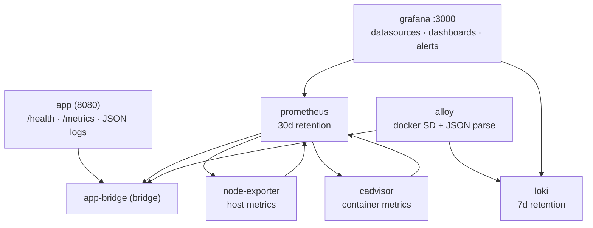

# CareGuide — Docker Compose + Observability Stack

## Context

`prompt.md` (Step 2 of the assessment) asks for two compose files:

1. `docker-compose.yml` — the app on port 8080, app code in `/app`, a `/health` healthcheck, `restart: unless-stopped`, `mem_limit: 256m`, `cpus: 0.5`, on a bridge network named `app-bridge`.
2. `docker-compose.monitoring.yml` — Prometheus, Grafana, Loki, Grafana Alloy, Node Exporter and cAdvisor on the **same** `app-bridge` network, 30d Prometheus retention, 7d Loki retention, Alloy shipping container logs to Loki with structured-JSON parsing, provisioned Grafana datasources + three exported dashboards (Application, Host, Containers) each with a Loki logs panel next to the metrics, 4+ alerting rules, Grafana admin credentials in a secret, only Grafana published to the host, all image versions pinned.

## Confirmed decisions

| Area | Decision |
|---|---|
| Retention | Prometheus **30d**, Loki **7d** (line 11 of the prompt read as the Loki value) |
| Grafana credentials | Docker Compose **secret** → Grafana `GF_SECURITY_ADMIN_PASSWORD__FILE` |
| Alerting | **Grafana unified alerting** (provisioned rules + a webhook contact point) |

## Repo findings that change the work

- The app image lives in `app/` (`app/Dockerfile`), **not** at the repo root. The existing root `docker-compose.yml` has `build: .`, which cannot build.
- `app/Dockerfile` sets `PORT=8080`, `EXPOSE 8080`, `PYTHONPATH=/app/src`, `WORKDIR /app`. The existing compose maps `8080:8000` and forces `PORT: "8000"`, and its healthcheck probes `127.0.0.1:8000/health` — every one of those contradicts the image. The app must be published as `8080:8080` with the healthcheck on `8080`.
- The app exposes `GET /metrics` with `http_requests_total{method,route,status_code}`, `http_request_errors_total{...}` and the `http_request_duration_seconds` histogram (buckets 5 ms → 10 s). Scrapes of `/metrics` are excluded from the counters, so Prometheus self-polling does not inflate them.
- Log lines are single-line JSON with `level`, `route`, `path`, `status_code`, `duration_ms`, `request_id`, `method`; stdout = INFO and below, stderr = WARNING and above. `route` is a template (`/`, `/health`) so it is safe as a label; the raw `path` is not (404 paths would explode cardinality).
- `docker-compose.monitoring.yml`, `k8s/Chart.yaml`, `IaC/run.sh`, `ci.yml`, `app/ci.yml` and `system_health_app/` are empty placeholders — out of scope.
- No `.gitignore` at the repo root, and no `.env` file exists anywhere.

## Target file layout

```
docker-compose.yml                        # rewritten: app service only
docker-compose.monitoring.yml              # six monitoring services
monitoring/
├── prometheus/prometheus.yml              # scrape configs
├── loki/loki-config.yml                   # limits + compactor (7d retention)
├── alloy/config.alloy                     # docker SD -> json parse -> loki.write
└── grafana/
    ├── provisioning/datasources/datasources.yml
    ├── provisioning/dashboards/dashboards.yml
    ├── provisioning/dashboards/application.json
    ├── provisioning/dashboards/host.json
    ├── provisioning/dashboards/containers.json
    ├── provisioning/alerting/contact-points.yaml
    └── provisioning/alerting/alerting.yaml
secrets/
├── grafana_admin_password.txt             # mounted as the compose secret
└── grafana_admin_password.txt.example     # template for rotation
docs/monitoring.md                         # runbook (added in T9)
```

## Network design (and the one gotcha)

`app-bridge` is a **single, fixed-name** bridge network shared by both stacks.

- `docker-compose.yml` declares it with `name: app-bridge`, `driver: bridge` → this project **creates** it.
- `docker-compose.monitoring.yml` declares it with `name: app-bridge`, `external: true` → it **attaches** to the existing network instead of trying to create a second one with the same name.

Two independent Compose projects each declaring `name: app-bridge` without `external: true` collide ("network app-bridge was found but has incorrect label"), so the `external` marker is required. Operational consequence, documented in the runbook: the app stack must come up first, or the network must be created by hand with `docker network create app-bridge` (idempotent, safe to run before either stack).

Prometheus resolves the app by its Compose network alias `app` → scrape target `app:8080/metrics`.

## Service specification

| Service | Image pin (verify tag exists at implementation time) | Published | Key settings |
|---|---|---|---|
| `app` | built from `app/` (`careguide/system-health:1.0.0`) | `8080:8080` | `restart: unless-stopped`, `mem_limit: 256m`, `cpus: 0.5`, healthcheck on `http://127.0.0.1:8080/health`, `app-bridge` |
| `prometheus` | `prom/prometheus:v2.54.1` | none | `--storage.tsdb.retention.time=30d`, `--config.file`, `--web.enable-lifecycle` |
| `loki` | `grafana/loki:3.2.1` | none | `limits_config.retention_period: 168h`, `compactor.retention_enabled: true`, `delete_request_store: filesystem`, TSDB schema v13 |
| `alloy` | `grafana/alloy:v1.5.1` | none (UI 12345 stays internal) | `/var/run/docker.sock:ro`, `config.alloy` mounted |
| `node-exporter` | `prom/node-exporter:v1.8.2` | none | `/proc`, `/sys`, `/` → `/host` ro, `--path.rootfs=/host` |
| `cadvisor` | `gcr.io/cadvisor/cadvisor:v0.49.1` | none | privileged, `/var/run`, `/sys`, `/var/lib/docker`, `/dev/disk` mounted |
| `grafana` | `grafana/grafana:11.2.0` | `3000:3000` | secret-backed admin password, provisioned datasources/dashboards/alerts, `extra_hosts: host.docker.internal:host-gateway` for the alert webhook |

Fallback tags if a pin has moved: `prom/prometheus:v2.55.1`, `grafana/grafana:11.3.0`, `grafana/loki:3.3.2`, `grafana/alloy:v1.6.0`, `prom/node-exporter:v1.9.0`, `gcr.io/cadvisor/cadvisor:v0.50.0`.

## Prometheus scrape configuration

| Job | Target | Interval |
|---|---|---|
| `app` | `app:8080/metrics` | 15s |
| `node` | `node-exporter:9100` | 15s |
| `cadvisor` | `cadvisor:8080/metrics` | 15s |
| `prometheus` | `localhost:9090` | 15s |

Job names matter — the dashboards and alert rules filter on `job="app"`, `job="node"` and `job="cadvisor"`.

## Alloy log pipeline

```alloy
discovery.docker "containers" { host = "unix:///var/run/docker.sock" }
discovery.relabel "containers" { ... target_label = "container" }   // __meta_docker_container_name -> container
loki.source.docker "containers" { targets = ..., forward_to = [loki.process.containers.receiver] }
loki.process "containers" {
  stage.json        { expressions = { level = "level", route = "route", status_code = "status_code" } }
  stage.labels      { values = { level = "", route = "" } }        // low cardinality labels only
  stage.structured_metadata { values = { request_id = "", duration_ms = "", status_code = "" } }
  stage.static_labels { values = { service = "system-health" } }
}
loki.write "default" { endpoint { url = "http://loki:3100/loki/api/v1/push" } }
```

Label policy (keeps cardinality bounded, as the prompt requires): **labels** = `level`, `route`, `container`, `service`; **structured metadata** = `request_id`, `status_code`, `duration_ms` (filterable in Grafana without becoming index labels). The raw `path` field is deliberately *not* promoted to a label.

## Dashboard catalogue (three exported JSON dashboards)

| Dashboard | Panels | PromQL |
|---|---|---|
| **Application** | request rate, error rate %, latency p50/p95/p99, 5xx rate, **Loki logs panel** | `sum(rate(http_requests_total{job="app"}[5m]))`; `sum(rate(http_request_errors_total{job="app"}[5m])) / sum(rate(http_requests_total{job="app"}[5m]))`; `histogram_quantile(0.50\|0.95\|0.99, sum by (le) (rate(http_request_duration_seconds_bucket{job="app"}[5m])))` |
| **Host** | CPU %, memory %, disk % by mountpoint, network rx/tx | `100 - avg(rate(node_cpu_seconds_total{mode="idle"}[5m])) * 100`; `100 - node_memory_MemAvailable_bytes / node_memory_MemTotal_bytes * 100`; `100 - node_filesystem_avail_bytes{mountpoint="/"} / node_filesystem_size_bytes{mountpoint="/"} * 100`; `sum(rate(node_network_receive_bytes_total[5m]))` |
| **Containers** | per-container CPU, per-container memory, **memory vs configured limit**, memory limit | `sum by (name) (rate(container_cpu_usage_seconds_total{name!=""}[5m]))`; `sum by (name) (container_memory_usage_bytes{name!=""})`; `container_memory_usage_bytes{name!=""} / container_spec_memory_limit_bytes{name!=""}` (guarded by `limit > 0`) |

Each dashboard is provisioned through the dashboards provider (`/var/lib/grafana/dashboards`), references the datasources by fixed UID (`prometheus`, `loki`), and the **Application** dashboard carries the Loki logs panel (`{service="system-health"} |= "..."`) next to the error-rate panel so an error spike can be investigated in the same view.

## Alerting rules (Grafana unified alerting)

| Rule | Expression | For |
|---|---|---|
| App instance down | `up{job="app"} == 0` | 1m |
| High error rate | `sum(rate(http_request_errors_total{job="app"}[5m])) / sum(rate(http_requests_total{job="app"}[5m])) > 0.05` | 5m |
| Host disk usage above 80% | `100 - (node_filesystem_avail_bytes{mountpoint="/"} / node_filesystem_size_bytes{mountpoint="/"} * 100) > 80` | 5m |
| Container memory close to limit | `container_memory_usage_bytes{name!=""} / container_spec_memory_limit_bytes{name!=""} > 0.9` | 5m |
| Host CPU saturation (extra) | `100 - (avg(rate(node_cpu_seconds_total{mode="idle"}[5m])) * 100) > 90` | 10m |
| App latency p95 above 1s (extra) | `histogram_quantile(0.95, sum by (le) (rate(http_request_duration_seconds_bucket{job="app"}[5m]))) > 1` | 5m |

Provisions via `monitoring/grafana/provisioning/alerting/` (`apiVersion: 1`): a contact point of type `webhook` pointing at `http://host.docker.internal:9093/alerts` (placeholder — swap for the real Slack/PagerDuty URL; rules still evaluate and list in Grafana when the endpoint is unreachable), plus the rule groups with `noDataState: NoData` / `execErrState: Error` and annotations carrying the summary, description and dashboard UID.

## Security & hygiene

- Grafana password lives in the Compose secret `grafana_admin_password` (file `secrets/grafana_admin_password.txt`) and is consumed through `GF_SECURITY_ADMIN_PASSWORD__FILE=/run/secrets/grafana_admin_password`. The committed file carries a placeholder value; `secrets/grafana_admin_password.txt.example` documents the rotation command (`openssl rand -base64 24`). Grafana user stays `admin`.
- Only Grafana publishes a host port (`3000`). Prometheus 9090, Loki 3100, Alloy 12345, node-exporter 9100 and cAdvisor 8080 stay on `app-bridge` only.
- Docker socket is mounted read-only into Alloy, and cAdvisor runs privileged with host paths — documented as the standard trade-off for container/host metrics.
- All images are version-pinned; no `latest` tags.

## Task details

### T1 — Rewrite `docker-compose.yml`
`build: ./app`; `image: careguide/system-health:1.0.0`; `ports: ["8080:8080"]`; `environment` matching the image (`PORT=8080`, `LOG_LEVEL=INFO`, `LOG_FORMAT=json`, `APP_VERSION=1.0.0`); `restart: unless-stopped`; healthcheck probing `http://127.0.0.1:8080/health` with `interval: 30s`, `timeout: 5s`, `start_period: 10s`, `retries: 3`; `mem_limit: 256m`; `cpus: 0.5`; `networks: [app-bridge]`; top-level `networks.app-bridge` with `name: app-bridge`, `driver: bridge`.
**Acceptance:** `docker compose config` validates; `docker compose up -d` starts the app and `docker inspect` reports `healthy`; `curl localhost:8080/health` returns `{"status":"healthy",...}`.

### T2 — Write `docker-compose.monitoring.yml`
The six services above, all on `app-bridge` (`external: true`, `name: app-bridge`), pinned images, only Grafana published, per-service `mem_limit`/`cpus` budgets (prometheus 1g/1.0, loki 1g/1.0, grafana 512m/0.5, alloy 512m/0.5, node-exporter 256m/0.3, cadvisor 512m/0.5), named volumes for Prometheus data, Loki chunks/rules and Grafana data, `depends_on` ordering (alloy → loki healthy, grafana → prometheus + loki healthy), and the Grafana secret mounted at `/run/secrets/grafana_admin_password`.
**Acceptance:** `docker compose -f docker-compose.monitoring.yml config` validates; every service reaches `running`/`healthy`; no monitoring port is published except 3000.

### T3 — Prometheus config
`monitoring/prometheus/prometheus.yml` with the four scrape jobs above and `--storage.tsdb.retention.time=30d` wired through the command args.
**Acceptance:** `/api/v1/targets` shows all four jobs `up`; the app target reports `http_requests_total` samples.

### T4 — Loki config
`monitoring/loki/loki-config.yml`: `common` block with `path_prefix: /loki` and filesystem storage, `schema_config` (tsdb, v13, 24h index period), `limits_config.retention_period: 168h`, `compactor` with `retention_enabled: true` + `delete_request_store: filesystem`, `analytics.reporting_enabled: false`.
**Acceptance:** Loki `/ready` returns 200; a pushed JSON line is queryable via `/loki/api/v1/query_range`; the retention setting is visible in `/config`.

### T5 — Alloy config
`monitoring/alloy/config.alloy` implementing the pipeline in *Alloy log pipeline* above, with `discovery.docker` + `discovery.relabel` + `loki.source.docker` + `loki.process` (json → labels → structured metadata) + `loki.write`.
**Acceptance:** Alloy UI shows the targets as healthy; a request to the app produces a Loki line carrying the `level` and `route` labels and `request_id` as structured metadata.

### T6 — Grafana provisioning: datasources, dashboard provider, secret
`monitoring/grafana/provisioning/datasources/datasources.yml` (Prometheus `http://prometheus:9090` uid `prometheus`; Loki `http://loki:3100` uid `loki`) and `monitoring/grafana/provisioning/dashboards/dashboards.yml` (provider, path `/var/lib/grafana/dashboards`, `updateIntervalSeconds: 30`, `allowUiUpdates: false`).
**Acceptance:** `/api/datasources` lists both datasources with the expected UIDs and are in a healthy state.

### T7 — Three dashboard JSON files
`application.json`, `host.json`, `containers.json` with the panels and PromQL in *Dashboard catalogue*, including the Loki logs panel on the Application dashboard. Datasources referenced by UID, not by name.
**Acceptance:** all three appear in `/api/search?type=dash-db`; each panel query returns data (no "no data" caused by a wrong UID or job label).

### T8 — Alerting rules and contact point
`monitoring/grafana/provisioning/alerting/contact-points.yaml` and `alerting.yaml` with the six rules above, `condition` wired to a `__expr__` reduce step, `noDataState`/`execErrState` set, and annotations.
**Acceptance:** `/api/v1/provisioning/alert-rules` lists 6 rules; the "host disk usage" rule evaluates to a known state and the rule list in the UI shows the contact point bound.

### T9 — Runbook and secret hygiene
`docs/monitoring.md` — prerequisites, `docker network create app-bridge` bootstrap, bring-up order, Grafana URL, credential location, dashboard/alert inventory, rotation command for the secret, image pins table, and the host-path/privileged caveat for cAdvisor and the Alloy socket mount.
**Acceptance:** the commands in the document are copy-pasteable and work from a clean machine.

### T10 — Verification pass
Bring the stack up, confirm every target/scrape/datasource/alert, then write the results up.

## Out of scope

`k8s/Chart.yaml` (Helm), `IaC/run.sh`, the GitHub Actions pipelines (`ci.yml`, `app/ci.yml`), the duplicate `system_health_app/` tree, and any change to the app source under `app/src/`.

## Verification

**Load check** — the whole stack comes up and every service is wired:

1. `docker compose config` and `docker compose -f docker-compose.monitoring.yml config` both validate.
2. `docker compose up -d` → `docker compose ps` shows the app `healthy`; `curl -s localhost:8080/health` → `{"status":"healthy",...}`; `curl -s localhost:8080/metrics` contains `http_requests_total`.
3. `docker compose -f docker-compose.monitoring.yml up -d` → all six services running; `curl -s localhost:3000/api/health` → `{"database":"ok",...}`; `curl -s localhost:3000/api/datasources` lists `prometheus` and `loki`.
4. `curl -s localhost:3000/api/v1/provisioning/alert-rules` lists 6 rules.
5. `docker exec` into Prometheus: `/api/v1/targets` → all four jobs `up`; `/api/v1/query` for `sum(rate(http_requests_total{job="app"}[5m]))` returns a value after a test request to the app.
6. Loki: `curl -s localhost:3100/ready` (via `docker exec`) → ready; a `query_range` over `{service="system-health"}` returns the app's access-log lines with `level` and `route` labels.
7. `curl -s localhost:3000/api/search?type=dash-db` → three dashboards; each dashboard's panel queries return data.
8. `docker compose ps` shows no published port other than 8080 (app) and 3000 (Grafana); `docker inspect` shows the Grafana password coming from `/run/secrets/grafana_admin_password` and no plaintext password in the environment.


