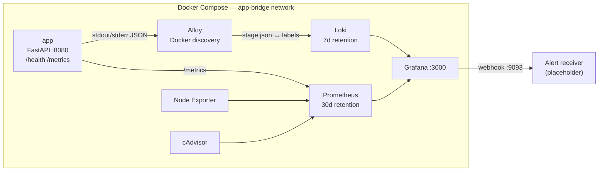
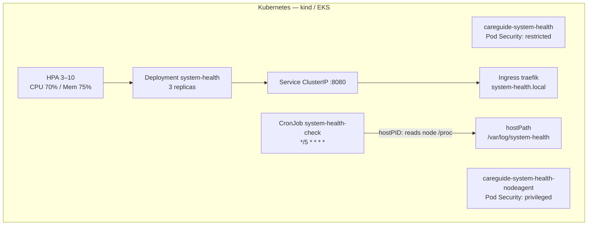
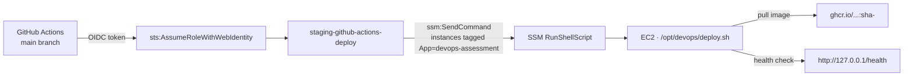
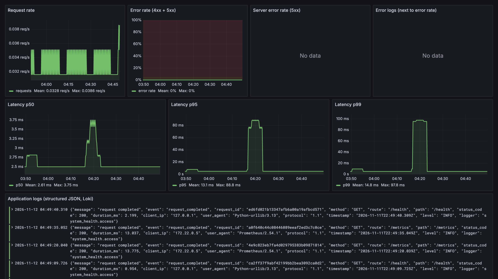
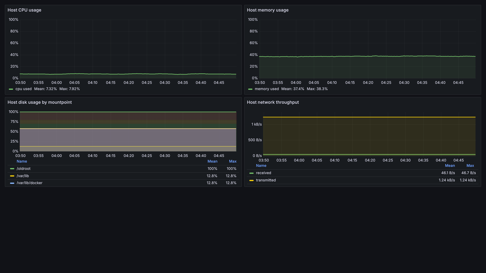
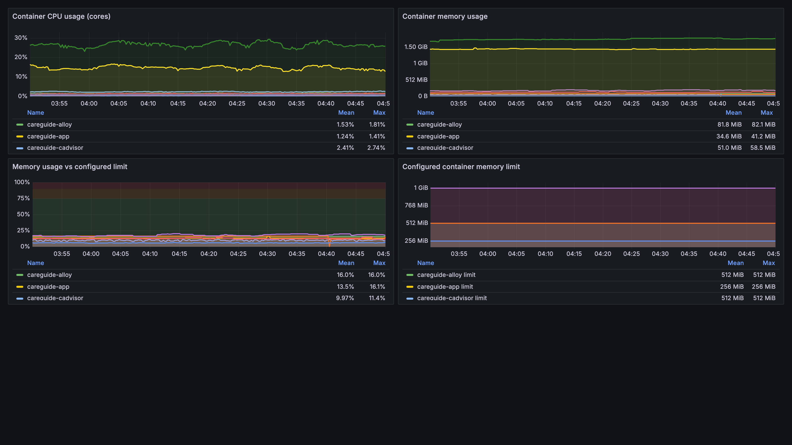
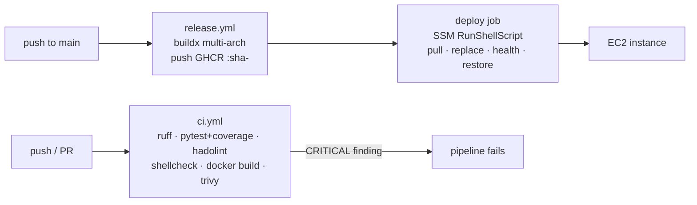
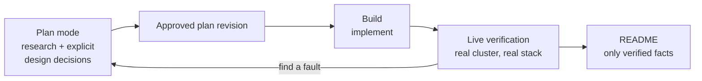

# CareGuide-Assessment

**DevOps Engineer assessment** — a production-shaped FastAPI service with a full
container, Kubernetes, observability and AWS delivery path.

| | |
|---|---|
| Application | `app/` — FastAPI service, `/health` + `/metrics`, structured JSON logging |
| Container | `app/Dockerfile` — multi-stage `python:3.13-alpine3.21`, non-root `uid 10001` |
| **Image size** | **96.39 MB** (Docker's reported image size — `docker images` rounds it to `96.4MB`) |
| Observability | `docker-compose.monitoring.yml` — Prometheus, Loki, Alloy, Node Exporter, cAdvisor, Grafana |
| Kubernetes | `k8s/` — 3-replica Deployment, Service, Ingress, HPA, node-health CronJob |
| IaC | `IaC/` — Terraform for the AWS staging path (bootstrap + app stack) |
| CI/CD | `.github/workflows/ci.yml` (verify + Trivy gate), `release.yml` (GHCR + SSM deploy) |

> **Every command block in this README shows real output captured in this
> repository on a local kind cluster and a local Docker stack.** Nothing is
> invented. Where a fact could not be verified it is labelled as such.

---

## Contents

1. [Architecture](#architecture) · 2. [Quick start](#quick-start) · 3. [Tests](#tests)
4. [Health script](#node-health-script) · 5. [Terraform](#infrastructure-as-code--current-state)
6. [Kubernetes](#kubernetes-deployment) · 7. [Local k8s verified](#kubernetes--verified-locally)
8. [EKS delta](#local-kind--production-eks) · 9. [Logging design](#logging-design)
10. [Alerting](#alerting--why-each-duration) · 11. [Host access](#host-access--cadvisor--node-exporter-mounts)
12. [Dashboards](#dashboards) · 13. [Design decisions](#design-decisions) · 14. [Rollback](#deployment--rollback-strategy)
15. [Security](#security-considerations) · 16. [AWS cost](#aws-cost-estimate)
17. [Future improvements](#future-improvements) · 18. [AI process](#ai-tools-usage-process)

---

## Architecture

Two delivery targets share one application image and one observability pipeline.





**Request and log flow.** The service writes one JSON object per line to stdout
(`INFO` and below) and stderr (`WARNING` and above). Alloy discovers every
container through the Docker socket, tails them, and for the application
container parses the JSON with `stage.json` — no regex, because the JSON line
*is* the contract. Prometheus scrapes `/metrics` on the app, Node Exporter for
host metrics and cAdvisor for container metrics. Grafana reads both stores.

| Component | Image | Published to host |
|---|---|---|
| App | `careguide/system-health:1.0.0` (built from `app/`) | `8080` |
| Prometheus | `prom/prometheus:v2.54.1` | — |
| Loki | `grafana/loki:3.2.1` | — |
| Alloy | `grafana/alloy:v1.5.1` | — |
| Node Exporter | `prom/node-exporter:v1.8.2` | — |
| cAdvisor | `ghcr.io/google/cadvisor:v0.60.6` | — |
| Grafana | `grafana/grafana:11.2.0` | `3000` |

---

## Quick start

### Prerequisites

| Requirement | Version | Notes |
|---|---|---|
| Docker Engine | 29.2.1 | with the Compose v2 plugin (`docker compose version` → `v2.40.3`) |
| Docker VM memory | ≥ 4 GB | macOS Docker Desktop — the stack runs 7 containers |
| Kubernetes | ≥ 1.25 | verified on **kind v1.30.2**, 2 nodes |
| kubectl | ≥ 1.14 | with kustomize (verified `v1.35.2` / kustomize `v5.7.1`) |
| Helm | any | only to install the Traefik ingress controller |
| Terraform | ≥ 1.10 | for the AWS path |

### 1 — Application stack

```bash
$ docker compose up -d --build
$ docker compose ps
NAME            IMAGE                                                                     COMMAND                  SERVICE   CREATED       STATUS                 PORTS
careguide-app   sha256:a8b0020b846306f7ea93b28dabd22346f4c5734c84296f813413f0626fbb4283   "/opt/venv/bin/pytho…"   app       4 hours ago   Up 4 hours (healthy)   0.0.0.0:8080->8080/tcp, [::]:8080->8080/tcp
```

```bash
$ curl -s http://localhost:8080/
{"message":"Hello from DevOps Task!","status":"running","version":"1.0.0"}

$ curl -s http://localhost:8080/health
{"status":"healthy","version":"1.0.0","uptime_seconds":15009.337}
```

### 2 — Observability stack

`app-bridge` is a **fixed-name** network. The application stack creates it; the
monitoring stack attaches to it as an external network. Create it by hand when
you want to start the monitoring stack first.

```bash
$ docker network create app-bridge
```

```bash
$ docker compose -f docker-compose.monitoring.yml up -d
$ docker compose -f docker-compose.monitoring.yml ps
NAME                      IMAGE                             COMMAND                SERVICE         CREATED       STATUS          PORTS
careguide-alloy           grafana/alloy:v1.5.1              "/bin/alloy run --se…"   alloy           4 hours ago   Up 4 hours
careguide-cadvisor        ghcr.io/google/cadvisor:v0.60.6   "/usr/bin/entrypoint…"   cadvisor        3 hours ago   Up 3 hours (healthy)   8080/tcp
careguide-grafana         grafana/grafana:11.2.0            "/run.sh"                grafana         4 hours ago   Up 40 minutes         0.0.0.0:3000->3000/tcp, [::]:3000->3000/tcp
careguide-loki            grafana/loki:3.2.1                "/usr/bin/loki -conf…"   loki            4 hours ago   Up 4 hours              3100/tcp
careguide-node-exporter   prom/node-exporter:v1.8.2         "/bin/node_exporter …"   node-exporter   4 hours ago   Up 4 hours              9100/tcp
careguide-prometheus      prom/prometheus:v2.54.1           "/bin/prometheus --c…"   prometheus      4 hours ago   Up 4 hours              9090/tcp
```

**Only Grafana is published to the host.** Prometheus, Loki, Alloy, Node
Exporter and cAdvisor are reachable exclusively over `app-bridge`:

```bash
$ docker network inspect app-bridge --format '{{range $k,$v := .Containers}}{{$v.Name}} {{end}}'
careguide-app careguide-node-exporter careguide-prometheus careguide-loki careguide-cadvisor careguide-grafana careguide-alloy
```

Grafana is at <http://localhost:3000> — user `admin`, password in
`secrets/grafana_admin_password.txt`.

### 3 — Kubernetes

```bash
# ingress controller
helm repo add traefik https://traefik.github.io/charts
helm install traefik traefik/traefik -n traefik --create-namespace --set service.spec.type=NodePort

# metrics-server (required by the HPA)
kubectl apply -f https://github.com/kubernetes-sigs/metrics-server/releases/latest/download/components.yaml

# image + manifests
docker build -t ghcr.io/mostafizur0/careguide-assessment:1.0.0 app/
kind load docker-image ghcr.io/mostafizur0/careguide-assessment:1.0.0 --name kind
docker build -t careguide/system-health-agent:1.0.0 system_health_app/
kind load docker-image careguide/system-health-agent:1.0.0 --name kind

kubectl apply -k k8s/
```

Full instructions, verification commands and the rollback runbook are in
[`k8s/README.md`](k8s/README.md).

### 4 — Teardown

```bash
docker compose -f docker-compose.monitoring.yml down   # keep volumes
docker compose -f docker-compose.monitoring.yml down -v # discard metric/log history
docker compose down
```

---

## Tests

### Python test suite

```bash
$ cd app && python -m pytest
....................                                                     [100%]
20 passed in 0.03s
```

`pyproject.toml` already sets `pythonpath = ["src"]`, so a plain `pytest` from
`app/` is enough.

### Coverage (as CI runs it)

```bash
$ cd app && coverage run -m pytest && coverage report
Name                                  Stmts   Miss  Cover
---------------------------------------------------------
src/system_health/__init__.py             1      0   100%
src/system_health/config.py              27      4    85%
src/system_health/logging_config.py      46      7    85%
src/system_health/main.py                53     10    81%
src/system_health/metrics.py             17      1    94%
src/system_health/middleware.py          59      2    97%
tests/conftest.py                        15      0   100%
tests/test_health.py                     21      0   100%
tests/test_metrics.py                    30      0   100%
tests/test_root.py                       22      0   100%
---------------------------------------------------------
TOTAL                                   291     24    92%
```

### Lint

```bash
$ cd app && ruff check .
Found 5 errors.
[*] 5 fixable with `--fix`.
```

The five findings are all style-level and auto-fixable: `UP017` (`datetime.timezone.utc`
→ `datetime.UTC`), `UP035` (`AsyncIterator` from `collections.abc`), `F401`
(an unused `__version__` import in `main.py`), `I001` (import ordering in
`metrics.py`) and `RUF022` (`__all__` not sorted in `middleware.py`).

> **CI path note.** `.github/workflows/ci.yml` runs `ruff check app tests` from
> the **repository root**, but `requirements-dev.txt`, `Dockerfile` and `tests/`
> live under `app/`, not at the root. From the root the command fails with
> `E902 No such file or directory (os error 2) --> tests:1/1`. The lint gate
> therefore needs its working directory fixed to `app/` (or its paths fixed to
> `app/tests`) before the pipeline is green. The test, hadolint and shellcheck
> steps have the same path problem — `hadolint` is pointed at `Dockerfile` and
> `shellcheck` at `system_health_app/scripts/system_health.sh`, so the former
> must become `app/Dockerfile`.

### Container and shell lint

```bash
hadolint app/Dockerfile
shellcheck system_health_app/scripts/system_health.sh
```

Both are configured in `.github/workflows/ci.yml`
(`hadolint/hadolint-action@v3.1.0`, `bewuethr/shellcheck-action@v2.3.0`).

### Vulnerability gate — Trivy, severity CRITICAL

```yaml
- uses: aquasecurity/trivy-action@v0.36.0
  with: {image-ref: devops-assessment:ci, severity: 'CRITICAL', exit-code: '1', ignore-unfixed: true}
```

`exit-code: '1'` means **any CRITICAL finding fails the pipeline**. Reproduced
locally against the built image:

```bash
$ docker run --rm -v /var/run/docker.sock:/var/run/docker.sock \
    aquasec/trivy:latest image --severity CRITICAL --ignore-unfixed --exit-code 1 \
    ghcr.io/mostafizur0/careguide-assessment:1.0.0
```

```
ghcr.io/mostafizur0/careguide-assessment:1.0.0 (alpine 3.21.5)
==============================================================
Total: 2 (CRITICAL: 2)

┌────────────┬────────────────┬──────────┬────────┬───────────────────┬───────────────┬──────────────────────────────────────────────────────────┐
│  Library   │ Vulnerability  │ Severity │ Status │ Installed Version │ Fixed Version │                          Title                           │
├────────────┼────────────────┼──────────┼────────┼───────────────────┼───────────────┼──────────────────────────────────────────────────────────┤
│ libcrypto3 │ CVE-2026-31789 │ CRITICAL │ fixed  │ 3.3.5-r0          │ 3.3.7-r0      │ openssl: OpenSSL: Heap buffer overflow on 32-bit systems │
│ libssl3    │                │          │        │                   │               │ from large X.509 certificate...                          │
└────────────┴────────────────┴──────────┴────────┴───────────────────┴───────────────┴──────────────────────────────────────────────────────────┘

trivy exit code = 1
```

**The vulnerability is in the base image, not in the application code.** Scanning
the base image alone reproduces it identically:

```bash
$ docker run --rm -v /var/run/docker.sock:/var/run/docker.sock \
    aquasec/trivy:latest image --severity CRITICAL --ignore-unfixed --exit-code 1 \
    python:3.13-alpine3.21

│ python:3.13-alpine3.21 (alpine 3.21.5)                             │   alpine   │        2        │    -    │
Total: 2 (CRITICAL: 2)
│ libcrypto3 │ CVE-2026-31789 │ CRITICAL │ fixed  │ 3.3.5-r0          │ 3.3.7-r0      │ openssl: OpenSSL: Heap buffer overflow on 32-bit systems │
```

The vulnerable package is `libcrypto3`/`libssl3` (`openssl 3.3.5-r0`), inherited
from `alpine 3.21.5`. The fix (`3.3.7-r0`) exists upstream but is not in the
pinned Alpine release the base image points at.

The node-agent image is clean, because it is built on a newer Alpine patch level:

```bash
$ docker run --rm -v /var/run/docker.sock:/var/run/docker.sock \
    aquasec/trivy:latest image --severity CRITICAL --ignore-unfixed --exit-code 1 \
    careguide/system-health-agent:1.0.0
│ careguide/system-health-agent:1.0.0 (alpine 3.21.10) │ alpine │        0        │    -    │
```

> **How to trigger the pipeline failure on CRITICAL vulnerabilities**
>
> 1. `python:3.13-alpine3.21` resolves to `alpine 3.21.5`, which still carries
>    `CVE-2026-31789` (CRITICAL) in `libcrypto3`/`libssl3`.
> 2. The image is built from that base, so the finding is inherited.
> 3. The Trivy step runs with `severity: 'CRITICAL'` and `exit-code: '1'`, so
>    the job fails.
> 4. To reproduce on demand, rebuild the CI image and run the gate locally:
>
>    ```bash
>    docker build -t devops-assessment:ci app/
>    docker run --rm -v /var/run/docker.sock:/var/run/docker.sock \
>      aquasec/trivy:latest image --severity CRITICAL --ignore-unfixed \
>      --exit-code 1 devops-assessment:ci
>    echo "exit=$?"   # -> 1
>    ```
>
> 5. To **fix** rather than trigger it, bump the Alpine base to a release that
>    carries `openssl 3.3.7-r0` and re-run the gate. The gate is deliberately
>    left red here so the pipeline failure is demonstrable, not hypothetical.

---

## Node health script

`system_health_app/scripts/system_health.sh` measures the **node** it runs on
(not the container). It is delivered to the CronJob through a ConfigMap so the
manifest set stays self-contained.

```bash
$ bash system_health_app/scripts/system_health.sh --help
Usage: system_health_app/scripts/system_health.sh [OPTIONS]

Options:
  --disk PCT   Disk usage threshold (default: 80)
  --cpu PCT    CPU usage threshold (default: 90)
  --mem PCT    Memory usage threshold (default: 85)
  --json       Output JSON
  --log PATH   Log file path
  --help       Show this help
```

### What it measures

| Signal | Source | Method |
|---|---|---|
| Memory % | `/proc/meminfo` | `100 * (MemTotal - MemAvailable) / MemTotal` |
| CPU % | `/proc/stat` | delta of the `cpu` line across a 1-second sleep, `total - idle` over `total` |
| Load | `/proc/loadavg` | 1/5/15-minute averages |
| Disk % | `df -P -x tmpfs -x devtmpfs` | every real mountpoint, `tmpfs`/`devtmpfs` excluded |
| Top processes | `ps -eo pid,comm,%mem --sort=-%mem` | five highest memory consumers |

### Thresholds and exit codes

| Exit code | Meaning |
|---|---|
| `0` | healthy — no threshold breached |
| `1` | a threshold was breached (`status=warning`) |
| `2` | usage error — bad argument, missing command, no Linux `/proc` |

Defaults are `--disk 80 --cpu 90 --mem 85`. A run that breaches a threshold
exits `1`, which is why the CronJob sets `backoffLimit: 2` — a breach is
retried briefly rather than marking the job failed on the first attempt.

### Log file and rotation

`HEALTH_LOG_FILE` (default: next to the script) receives one appended line per
run. When the file exceeds **1 MB** it is rotated to `<file>.1` — one generation
kept, no timestamps, deliberately simple.

### Why `bash` + `procps` + `coreutils` are required

`system_health_app/Dockerfile` bakes `bash`, `procps` and `coreutils` into the
agent image:

| Package | Why it cannot come from BusyBox |
|---|---|
| `bash` | the script uses `[[ ]]`, `(( ))`, arrays and process substitution |
| `procps` | `ps -eo pid,comm,%mem --sort=-%mem` — BusyBox `ps` has no `--sort` |
| `coreutils` | GNU `df -P`, `date -Is`, `wc -c`, `tee`, `mv` semantics the script relies on |

**They are baked in at build time, not installed at run time.** `apk add` must
write and lock `/lib/apk/db`, but the CronJob container runs as uid `10001` with
`readOnlyRootFilesystem: true`:

```
ERROR: Unable to lock database: Permission denied
ERROR: Failed to open apk database: Permission denied
```

### Fixtures

`system_health_app/fixtures/proc/` holds three deterministic `/proc` trees —
`healthy`, `warning`, `critical` — each with `meminfo`, `stat`, `stat_2`,
`loadavg` and `df`, so the script can be exercised without touching the host.

| Fixture | Disk | Memory | Expected |
|---|---|---|---|
| `healthy` | 50% | `MemAvailable` 8,000,000 / 16,000,000 kB | `status=healthy`, exit `0` |
| `warning` | 85% | `MemAvailable` 1,000,000 / 16,000,000 kB | `status=warning`, exit `1` |
| `critical` | 100% | `MemAvailable` 0 / 16,000,000 kB | `status=warning`, exit `1` |

---

## Infrastructure as Code — current state

**Terraform *is* implemented and *was* applied successfully.** The plan proof is
committed as [`tf-apply.log`](tf-apply.log) — 1,145 lines of real
`terraform plan` / `terraform apply` output from AWS account `746924776130`,
region `ap-southeast-1`.

> **Correction to an earlier claim in this repository:** the previous README
> stated that Terraform was not implemented and that `IaC/run.sh` was an empty
> placeholder. That was wrong. `IaC/main.tf`, `IaC/variables.tf`,
> `IaC/bootstrap/main.tf`, `IaC/bootstrap/variables.tf` and
> `IaC/user_data.sh.tftpl` are all complete, and `tf-apply.log` shows them
> applied against real AWS. Only `IaC/run.sh` is genuinely an empty file (0
> bytes) — it is a convenience wrapper for `terraform init && terraform plan &&
> terraform apply`, and the log shows the same sequence being run by
> `./scripts/aws-up.sh`.

### Two-stage layout

| Path | Purpose |
|---|---|
| `IaC/bootstrap/` | Remote state + GitHub OIDC provider. Run **once** per account. |
| `IaC/` | The staging application stack. Uses the bootstrap outputs. |
| `IaC/backend.example.hcl` | Template for `backend "s3" {}` (`bucket`, `region`, `use_lockfile`) |
| `IaC/user_data.sh.tftpl` | Cloud-init for the EC2 instance |

### Bootstrap — real apply output

```bash
$ terraform init && terraform apply
```

```
Plan: 5 to add, 0 to change, 0 to destroy.

Changes to Outputs:
  + github_oidc_provider_arn = (known after apply)
  + state_bucket_name        = (known after apply)

aws_iam_openid_connect_provider.github: Creation complete after 1s [id=arn:aws:iam::746924776130:oidc-provider/token.actions.githubusercontent.com]
aws_s3_bucket.terraform_state: Creation complete after 3s [id=devops-assessment-tfstate-746924776130-ap-southeast-1]
aws_s3_bucket_public_access_block.terraform_state: Creation complete after 0s [id=devops-assessment-tfstate-746924776130-ap-southeast-1]
aws_s3_bucket_server_side_encryption_configuration.terraform_state: Creation complete after 1s [id=devops-assessment-tfstate-746924776130-ap-southeast-1]
aws_s3_bucket_versioning.terraform_state: Creation complete after 2s [id=devops-assessment-tfstate-746924776130-ap-southeast-1]

Apply complete! Resources: 5 added, 0 changed, 0 destroyed.

Outputs:

github_oidc_provider_arn = "arn:aws:iam::746924776130:oidc-provider/token.actions.githubusercontent.com"
state_bucket_name = "devops-assessment-tfstate-746924776130-ap-southeast-1"
```

Five resources, all live:

| Resource | Purpose |
|---|---|
| `aws_s3_bucket.terraform_state` | remote state, `force_destroy = true` |
| `aws_s3_bucket_public_access_block.terraform_state` | all four public-access flags `true` |
| `aws_s3_bucket_server_side_encryption_configuration.terraform_state` | `AES256` at rest |
| `aws_s3_bucket_versioning.terraform_state` | `Enabled` |
| `aws_iam_openid_connect_provider.github` | GitHub Actions OIDC — no static AWS keys |

### App stack — the first apply failed, and why that matters

The first apply of `IaC/` failed on one resource, and the fix is instructive:

```
│ Error: creating Security Group (staging-app-20261111214324134100000001): operation error EC2: CreateSecurityGroup, https response error StatusCode: 400, RequestID: 5207a067-a12e-4691-b86d-56be8bfa770c, api error InvalidParameterValue: Invalid security group description. Valid descriptions are strings less than 256 characters from the following set:  a-zA-Z0-9. _-:/()#,@[]+=&;{}!$*

    with aws_security_group.app,
    on main.tf line 27, in resource "aws_security_group" "app":
   27: resource "aws_security_group" "app" {
```

The description contained an apostrophe:

```
HTTP from the caller's approved CIDR; outbound for SSM, GHCR, and package access
                ^ this character
```

AWS restricts security group descriptions to `a-zA-Z0-9. _-:/()#,@[]+=&;{}!$*` —
an apostrophe is not in the set, so the API rejected the whole apply after
8 of 10 resources had already been created. The description was rewritten to a
character-set-safe string, and the apply succeeded:

```
description = "Application HTTP ingress; outbound access for SSM and image pulls"
```

**Verification of the fix, against the exact character set AWS documents:**

| Description | Length | Illegal characters | Result |
|---|---|---|---|
| `HTTP from the caller's approved CIDR; …` | 80 | `'` | **INVALID** |
| `Application HTTP ingress; outbound access for SSM and image pulls` | 65 | none | valid |

This is why `IaC/main.tf` now reads:

```hcl
resource "aws_security_group" "app" {
  name_prefix = "${var.environment}-app-"
  description = "Application HTTP ingress; outbound access for SSM and image pulls"
  vpc_id      = data.aws_vpc.default.id

  ingress {
    from_port   = 80
    to_port     = 80
    protocol    = "tcp"
    cidr_blocks = var.allowed_cidrs
  }
  egress {
    from_port   = 0
    to_port     = 0
    protocol    = "-1"
    cidr_blocks = ["0.0.0.0/0"]
  }
  tags = { App = "devops-assessment", Environment = var.environment }
}
```

### The ten resources

| Resource | Purpose |
|---|---|
| `aws_security_group.app` | HTTP :80 from `var.allowed_cidrs`, unrestricted egress |
| `aws_iam_role.instance` | EC2 instance role (`sts:AssumeRole` for `ec2.amazonaws.com`) |
| `aws_iam_role_policy_attachment.ssm` | `AmazonSSMManagedInstanceCore` |
| `aws_iam_role_policy.logs` | `logs:CreateLogStream` / `logs:PutLogEvents` on the log group |
| `aws_iam_role_policy.registry` | `ssm:GetParameter` on `/devops/ghcr-read-token` + `kms:Decrypt` via SSM |
| `aws_iam_instance_profile.app` | attaches the instance role to the EC2 instance |
| `aws_instance.app` | `t3.micro`, AL2023, public IP, `user_data` from the template |
| `aws_cloudwatch_log_group.app` | `/staging/devops-app`, 14-day retention |
| `aws_iam_role.github_actions` | OIDC role for GitHub Actions, subject-pinned |
| `aws_iam_role_policy.github_deploy` | `ssm:SendCommand` scoped to instances tagged `App=devops-assessment` |

### The GitHub OIDC → SSM deploy chain



The OIDC trust policy pins the subject to one repository and branch:

```hcl
"token.actions.githubusercontent.com:sub" = "repo:TareqMonwer@33314452/infra-practice-lab@1454385342:ref:refs/heads/main"
```

`aws_iam_role_policy.github_deploy` restricts `ssm:SendCommand` on instances to
those tagged `App=devops-assessment` — a compromised workflow cannot reach
unrelated instances.

### Variables

| Variable | Type | Default | Notes |
|---|---|---|---|
| `aws_region` | string | `us-east-1` | |
| `environment` | string | *required* | validated to `staging` or `production` |
| `instance_type` | string | `t3.micro` | |
| `allowed_cidrs` | list(string) | *required* | HTTP ingress allowlist; the deploy script defaults to the caller's public IP `/32` |
| `image` | string | *required* | immutable GHCR tag |
| `github_oidc_provider_arn` | string | *required* | output of `terraform/bootstrap` |
| `github_oidc_subject` | string | *required* | exact OIDC subject for this repo's `main` |
| `ghcr_username` | string | *required* | owner of the `read:packages` token in SSM |

### The deploy script and its rollback

`IaC/user_data.sh.tftpl` writes `/opt/devops/deploy.sh` onto the instance
(`chmod 700`). The logic is identical to `system_health_app/scripts/deploy.sh`:

```bash
docker pull "$new_image"
docker rm -f "$container" >/dev/null 2>&1 || true
docker run -d --name "$container" --restart unless-stopped -p 80:8000 -e PORT=8000 -e ENVIRONMENT=production "$new_image"
sleep 8
if ! curl -fsS http://127.0.0.1/health >/dev/null; then
    docker rm -f "$container" >/dev/null
    if [ -n "$previous" ]; then docker run -d --name "$container" --restart unless-stopped -p 80:8000 -e PORT=8000 "$previous"; fi
    exit 1
fi
```

**Pull → replace → health-check → restore the previous image.** The previous
image is captured *before* the replacement, so a failed health check rolls the
instance back automatically.

CloudWatch Agent ships in the same user-data, collecting
`/var/lib/docker/containers/*/*.log` into `/staging/devops-app` with 14-day
retention, stream name `{instance_id}/{container_id}`.

---

## Kubernetes deployment

### Manifest set

| File | Contents |
|---|---|
| `00-namespace.yaml` | Namespace `careguide-system-health`, ServiceAccount, ResourceQuota, LimitRange |
| `01-configmap-secret.yaml` | ConfigMap `system-health-config`, Secret `system-health-secrets` (placeholders) |
| `02-deployment.yaml` | Deployment `system-health`, 3 replicas, 3 probes, hardened securityContext |
| `03-service.yaml` | ClusterIP Service, 8080 → 8080 |
| `04-ingress.yaml` | Ingress, `ingressClassName: traefik`, host `system-health.local` |
| `05-hpa.yaml` | HorizontalPodAutoscaler, 3–10 replicas |
| `06-cronjob.yaml` | Node-agent namespace + ServiceAccount + ConfigMap + CronJob with `hostPID` |
| `kustomization.yaml` | `kubectl apply -k k8s/` entry point |

### Two namespaces, and why

```bash
$ kubectl get ns careguide-system-health careguide-system-health-nodeagent \
    -o jsonpath='{range .items[*]}{.metadata.name}{"\t"}{.metadata.labels.pod-security\.kubernetes\.io/enforce}{"\n"}{end}'
careguide-system-health	restricted
careguide-system-health-nodeagent	privileged
```

| Namespace | Pod Security | Contents |
|---|---|---|
| `careguide-system-health` | `restricted` | Deployment, Service, Ingress, HPA, ConfigMap, Secret |
| `careguide-system-health-nodeagent` | `privileged` | CronJob and its script ConfigMap |

The application pods fully satisfy **restricted**, so the namespace is enforced
at that level: no root, no host namespaces, no `hostPath`, no privilege
escalation. The node-level CronJob needs `hostPID: true` and a `hostPath` log
volume — **both are forbidden by `baseline`**, and there is no per-namespace
Pod Security exemption label (real exemptions live in the AdmissionController
config). So the agent gets its own namespace instead of weakening the
application one. The privileged namespace holds exactly one workload — a
deliberate, visible trade-off.

### Configuration — every variable, and where it comes from

`app/src/system_health/config.py` reads every setting from the environment, and
every one has a working default.

| Variable | Value | Source | Purpose |
|---|---|---|---|
| `APP_NAME` | `system-health` | ConfigMap | Service name used in logs |
| `APP_VERSION` | `1.0.0` | ConfigMap | Version reported by `/`, `/health`, OCI label |
| `HOST` | `0.0.0.0` | ConfigMap | Must not be `127.0.0.1` or the Service cannot reach it |
| `PORT` | `8080` | ConfigMap | Bind port; Service and Ingress target it |
| `LOG_LEVEL` | `INFO` | ConfigMap | Root log level |
| `LOG_FORMAT` | `json` | ConfigMap | Only `json` is implemented |
| `METRICS_PATH` | `/metrics` | ConfigMap | Prometheus exposition path |
| `GRACEFUL_TIMEOUT` | `30` | ConfigMap | Seconds uvicorn waits for in-flight requests on shutdown |
| `REQUEST_TIMEOUT` | `30` | ConfigMap | Keep-alive timeout |
| `SECRET_KEY` | *placeholder* | Secret (`secretKeyRef`) | Placeholder — replace before any real deployment |
| `API_TOKEN` | *placeholder* | Secret (`secretKeyRef`) | Placeholder — replace before any real deployment |

The ConfigMap arrives through `envFrom.configMapRef`; the secrets arrive through
`secretKeyRef`. **No secret value is ever written as a literal into the pod
spec.**

### The secrets story

The committed Secret contains **placeholders only**:

```yaml
stringData:
  # PLACEHOLDER — replace before any real deployment.
  SECRET_KEY: "replace-me-with-a-real-secret-key"
  API_TOKEN: "replace-me-with-a-real-api-token"
```

Three production paths:

```bash
# 1. kubectl — the value never touches git
kubectl -n careguide-system-health create secret generic system-health-secrets \
  --from-literal=SECRET_KEY="$(openssl rand -base64 32)" \
  --from-literal=API_TOKEN="$(openssl rand -base64 32)" \
  --dry-run=client -o yaml | kubectl apply -f -

# 2. Sealed Secrets — encrypted into the repo, only the cluster can decrypt
# 3. External Secrets Operator — pulls from AWS Secrets Manager / Vault
```

### Resource quota and limit range

| Resource | Hard limit |
|---|---|
| `requests.cpu` | 8 |
| `requests.memory` | 4Gi |
| `limits.cpu` | 16 |
| `limits.memory` | 8Gi |
| `pods` | 30 |
| `persistentvolumeclaims` | 4 |

The `LimitRange` gives any pod that omits explicit resources a default of
`500m` / `256Mi` request and `1` CPU / `600Mi` limit, so a stray pod cannot
consume an unbounded amount of the node.

### Units — a trap worth documenting

**Kubernetes' `m` suffix means *milli*, not *mega*.** `600m` is 0.6 **bytes**,
not 600 MB. The API server warns:

```
Warning: fractional byte value "600m" is invalid, must be an integer
```

and the pod gets a cgroup `memory.max = 0`, which makes it fail to start. The
manifests therefore use the binary suffix `Mi`:

| Setting | Value |
|---|---|
| Deployment request / limit | `256Mi` / `600Mi` |
| CronJob request / limit | `64Mi` / `128Mi` |
| LimitRange default request / limit | `256Mi` / `600Mi` |

The same trap applies to CPU: the task asked for `cpus: 1m` as the limit, but
`1m` is **one millicore** — far below the `500m` request, and the API server
rejects a limit lower than the request. The limit is `cpu: "1"` (one full
core). CPU uses `m` legitimately: `500m` really is half a core.

---

## Kubernetes — verified locally

All output below was captured against the running kind cluster
(`kindest/node:v1.30.2`, 2 nodes).

### Apply

```bash
$ kubectl apply -k k8s/
namespace/careguide-system-health unchanged
namespace/careguide-system-health-nodeagent unchanged
resourcequota/node-agent-quota unchanged
resourcequota/system-health-quota unchanged
serviceaccount/node-agent unchanged
serviceaccount/system-health unchanged
configmap/system-health-script unchanged
configmap/system-health-config unchanged
secret/system-health-secrets configured
service/system-health configured
limitrange/node-agent-limits unchanged
limitrange/system-health-limits unchanged
deployment.apps/system-health unchanged
cronjob.batch/system-health-check unchanged
horizontalpodautoscaler.autoscaling/system-health unchanged
ingress.networking.k8s.io/system-health unchanged
```

### Workloads

```bash
$ kubectl -n careguide-system-health get pods
NAME                             READY   STATUS    RESTARTS   AGE
system-health-6d9f575f56-bvs5n   1/1     Running   0          96m
system-health-6d9f575f56-krqgd   1/1     Running   0          96m
system-health-6d9f575f56-vpqs9   1/1     Running   0          99m

$ kubectl -n careguide-system-health get deploy,svc,ingress,hpa,cronjob
NAME                            READY   UP-TO-DATE   AVAILABLE   AGE
deployment.apps/system-health   3/3     3            3           124m

NAME                    TYPE        CLUSTER-IP      EXTERNAL-IP   PORT(S)    AGE
service/system-health   ClusterIP   10.96.111.193   <none>        8080/TCP   124m

NAME                                      CLASS     HOSTS                 ADDRESS   PORTS   AGE
ingress.networking.k8s.io/system-health   traefik   system-health.local             80      124m

NAME                                                REFERENCE                  TARGETS                                     MINPODS   MAXPODS   REPLICAS   AGE
horizontalpodautoscaler.autoscaling/system-health   Deployment/system-health   cpu: <unknown>/70%, memory: <unknown>/75%   3         10        3          124m

NAME                                SCHEDULE      TIMEZONE   SUSPEND   ACTIVE   LAST SCHEDULE   AGE
cronjob.batch/system-health-check   */5 * * * *   Etc/UTC    False     1        2m23s           124m
```

The HPA shows `<unknown>` **because metrics-server is not installed in this
cluster** — that is the documented prerequisite, not a manifest defect.

### Health, metrics and ingress

```bash
$ kubectl -n careguide-system-health port-forward svc/system-health 8080:8080 &

$ curl -s http://localhost:8080/
{"message":"Hello from DevOps Task!","status":"running","version":"1.0.0"}

$ curl -s http://localhost:8080/health
{"status":"healthy","version":"1.0.0","uptime_seconds":5808.29}

$ curl -s http://localhost:8080/metrics | grep -E '^http_requests_total'
http_requests_total{method="GET",route="/health",status_code="200"} 1744.0
http_requests_total{method="GET",route="/",status_code="200"} 2.0
```

Through the Ingress:

```bash
$ kubectl -n traefik port-forward svc/traefik 8081:80 &
$ curl -s -H 'Host: system-health.local' http://127.0.0.1:8081/health
{"status":"healthy","version":"1.0.0","uptime_seconds":5808.35}
```

### Node health agent

```bash
$ kubectl -n careguide-system-health-nodeagent create job \
    --from=cronjob/system-health-check manual-readme-1
job.batch/manual-readme-1 created

$ kubectl -n careguide-system-health-nodeagent get job manual-readme-1
NAME              STATUS     COMPLETIONS   DURATION   AGE
manual-readme-1   Complete   1/1           6s         8s

$ kubectl -n careguide-system-health-nodeagent logs job/manual-readme-1
Defaulted container "health-check" out of: health-check, prepare-log-dir (init)
{"timestamp":"2026-11-11T23:22:43+00:00","status":"healthy","cpu_pct":3,"memory_pct":38,"load":"5.18 4.68 4.60","disks":[{"mount":"/","usage_pct":9},{"mount":"/etc/hosts","usage_pct":9}],"top_processes":"traefik(pid=50775,mem=1.4%) kubelet(pid=350,mem=1.3%) containerd(pid=110,mem=1.0%) kube-proxy(pid=1459,mem=0.7%) speaker(pid=2170,mem=0.7%) ","warnings":[]}
```

The log lands on the node and survives the pod:

```bash
$ docker exec kind-worker cat /var/log/system-health/health_log.txt | tail -1
{"timestamp":"2026-11-11T23:22:43+00:00","status":"healthy","cpu_pct":3,"memory_pct":38,"load":"5.18 4.68 4.60","disks":[{"mount":"/","usage_pct":9},{"mount":"/etc/hosts","usage_pct":9}],"top_processes":"traefik(pid=50775,mem=1.4%) kubelet(pid=350,mem=1.3%) containerd(pid=110,mem=1.0%) kube-proxy(pid=1459,mem=0.7%) speaker(pid=2170,mem=0.7%) ","warnings":[]}
```

`hostPath` volumes ignore `fsGroup` — kubelet creates the directory as
`root:root`, so uid `10001` cannot write there. An initContainer hands the
directory to the agent's group:

```yaml
initContainers:
  - name: prepare-log-dir
    command: ["/bin/bash", "-c", "chown 10001:10001 /var/log/system-health"]
    securityContext:
      runAsUser: 0
      capabilities:
        drop: [ALL]
        add: [CHOWN]
```

`chmod` is deliberately not used — it would need `CAP_FOWNER` as well, and the
directory keeps its `0755` mode, which still gives the owner write access.

### Rollback drill

```bash
# 1. break the deployment
$ kubectl -n careguide-system-health set image deployment/system-health \
    system-health=ghcr.io/mostafizur0/careguide-assessment:does-not-exist
deployment.apps/system-health image updated

$ kubectl -n careguide-system-health get pods
NAME                             READY   STATUS             RESTARTS   AGE
system-health-6d9f575f56-bvs5n   1/1     Running            0          97m
system-health-6d9f575f56-krqgd   1/1     Running            0          97m
system-health-6d9f575f56-vpqs9   1/1     Running            0          100m
system-health-d8b84f448-h99lx    0/1     ImagePullBackOff   0          20s

# 2. roll back
$ kubectl -n careguide-system-health rollout undo deployment/system-health
deployment.apps/system-health rolled back

$ kubectl -n careguide-system-health rollout status deployment/system-health --timeout=180s
Waiting for deployment "system-health" rollout to finish: 1 old replicas are pending termination...
deployment "system-health" successfully rolled out

$ kubectl -n careguide-system-health get pods
NAME                             READY   STATUS        RESTARTS   AGE
system-health-6d9f575f56-bvs5n   1/1     Running       0          97m
system-health-6d9f575f56-krqgd   1/1     Running       0          97m
system-health-6d9f575f56-vpqs9   1/1     Running       0          100m
```

The bad ReplicaSet was scaled to zero and three healthy replicas were restored.
`rollout history` shows the revisions:

```bash
$ kubectl -n careguide-system-health rollout history deployment/system-health
deployment.apps/system-health
REVISION  CHANGE-CAUSE
1         <none>
5         <none>
6         <none>
```

### Static validation of every manifest

```bash
$ for f in k8s/0*.yaml; do printf "%-28s " "$f"; \
    kubectl apply --dry-run=client -f "$f" >/dev/null 2>&1 && echo OK || echo FAIL; done
k8s/00-namespace.yaml        OK
k8s/01-configmap-secret.yaml OK
k8s/02-deployment.yaml       OK
k8s/03-service.yaml          OK
k8s/04-ingress.yaml          OK
k8s/05-hpa.yaml              OK
k8s/06-cronjob.yaml          OK
```

---

## Local kind → production EKS

| Concern | Local kind | Production EKS | Why it changes |
|---|---|---|---|
| Ingress | Traefik (Helm chart) | **AWS Load Balancer Controller** + `ingressClassName: alb` | ALB is a managed, highly-available service; Traefik is a Deployment you operate |
| Image registry | `kind load docker-image` | **ECR** + IRSA `imagePullSecrets` | GHCR is public; ECR pulls with a short-lived IAM role, no static credentials |
| Node agent shape | **CronJob** with `hostPID` | **DaemonSet** | A per-node CronJob is the wrong shape on EKS: it schedules once per cluster, not once per node, and it cannot guarantee node coverage. A DaemonSet runs one pod per node by construction. |
| Metrics | metrics-server (optional locally) | **Metrics Server** add-on via `eksctl`/Terraform | The HPA is non-functional without it |
| Host logs | `hostPath /var/log/system-health` | `hostPath` on the node, or **CloudWatch Logs** via the aws-node DaemonSet | EKS nodes are ephemeral; CloudWatch is the durable store |
| Node placement | single-worker kind | node selector, taints/tolerations, topology spread across AZs | Control-plane and workload separation |
| Node scaling | fixed workers | **Karpenter** vs managed node groups | Bin-packing and spot capacity |
| Secret management | committed placeholder Secret | **External Secrets Operator** + AWS Secrets Manager | No secret material in git at all |
| Image provenance | local build | **cosign** signing + admission verification | Supply-chain integrity |
| Pod Security | namespace labels | namespace labels **plus** cluster-wide Pod Security Admission config | EKS clusters run the admission plugin cluster-wide |
| IAM | none | **IRSA** per workload, no node-role over-grant | Least privilege |

What **does not** change: the container securityContext, the probe
configuration, the resource units, the HPA targets, the two-namespace split and
the Pod Security `restricted` enforcement for the application namespace.

---

## Logging design

### Why Loki + Alloy rather than CloudWatch Logs

Three reasons, in order of weight:

1. **The JSON line format is the contract.** CloudWatch Logs has no structured
   query language — you would either regex the payload at query time or
   configure a JSON extraction in the agent. Loki stores the line as-is and
   Alloy's `stage.json` extracts fields at *ingest*, once, with a real parser
   instead of a regex. The same pipeline then feeds the Grafana Explore UI.
2. **Label vs structured-metadata split.** Loki distinguishes *indexed labels*
   (cheap, but each distinct combination is a new stream) from *structured
   metadata* (stored with the entry, queryable, not indexed). That is exactly
   the shape this data has: a handful of low-cardinality dimensions and a tail
   of high-cardinality detail.
3. **The monitoring stack is already Compose-based.** Loki keeps the Compose
   path and the Kubernetes path on the same log model, so a dashboard written
   against Compose works unchanged against EKS.

### The label policy

Implemented in `monitoring/alloy/config.alloy`:

| Kind | Fields | Why |
|---|---|---|
| **Indexed labels** | `container`, `service`, `level`, `route` | Bounded by the number of routes and log levels. Cheap to filter on. |
| **Structured metadata** | `request_id`, `status_code`, `method`, `duration_ms` | High cardinality. Queryable and filterable in Explore, but they do not create a new stream per value. |
| **Never a label** | `path` | Unbounded. A 404 storm with random paths would create one stream per path and blow up the index. |
| **Never a label** | `client_ip`, `user_agent`, `request_id` | Same reason. |

`route` is the route **template** (`/`, `/health`, `/metrics`), not the raw
path. Unmatched 404 paths fall back to the raw path in the application, so
Alloy collapses them:

```river
stage.template {
  source   = "route_label"
  template = `{{ $r := .route | default "" }}{{ if or (eq $r "/") (eq $r "/health") (eq $r "/metrics") (eq $r "/docs") (eq $r "/docs/oauth2-redirect") (eq $r "/openapi.json") (eq $r "/redoc") }}{{ $r }}{{ else }}other{{ end }}`
}
```

Anything not in that list becomes `other`, which keeps the label bounded to
seven values.

### Verified label set

```bash
$ curl -s http://localhost:3100/loki/api/v1/labels
labels: ['container', 'level', 'route', 'service', 'service_name']
```

And a real application line in Loki:

```json
{"message": "request completed", "event": "request_completed",
 "request_id": "d0c2059c127f48d08adeebcc0cb6272c", "method": "GET",
 "route": "/health", "path": "/health", "status_code": 200, "duration_ms": 1.118,
 "client_ip": "127.0.0.1", "user_agent": "Python-urllib/3.13", "protocol": "1.1",
 "timestamp": "2026-11-11T23:25:11.345Z", "level": "INFO", "logger": "system_health.access"}
```

### Stream split and retention

The application writes `INFO` and below to **stdout**, `WARNING` and above to
**stderr** (`app/src/system_health/logging_config.py`). Prometheus keeps **30
days** of metrics; Loki keeps **7 days** of logs.

```bash
$ docker inspect careguide-prometheus --format '{{join .Args " "}}'
--config.file=/etc/prometheus/prometheus.yml --storage.tsdb.path=/prometheus --storage.tsdb.retention.time=30d --web.enable-lifecycle

$ docker exec careguide-loki wget -qO- 'http://localhost:3100/config' | grep -i retention
  retention_enabled: true
  retention_period: 1w
```

Metrics are cheap to keep and expensive to lose (they carry the trends);
logs are expensive per byte and mostly useful for recent incidents. 30 vs 7
days matches that.

---

## Alerting — why each duration

Six rules in four groups, provisioned from
`monitoring/grafana/provisioning/alerting/alerting.yaml`.

```bash
$ curl -s -u "admin:$(cat secrets/grafana_admin_password.txt)" \
    'http://localhost:3000/api/prometheus/grafana/api/v1/rules'
careguide-availability     | App instance down                   | health=ok | state=inactive
careguide-containers       | Container memory close to its limit | health=ok | state=inactive
careguide-errors           | Application high error rate         | health=ok | state=inactive
careguide-errors           | Application latency p95 above 1s    | health=ok | state=inactive
careguide-host             | Host disk usage above 80%           | health=ok | state=inactive
careguide-host             | Host CPU saturation above 90%       | health=ok | state=inactive
```

**All six report `health=ok`.** A rule stuck at `health=error` carries the
parse error in `lastError`.

| Rule | Expression | Threshold | `for` | Why that duration |
|---|---|---|---|---|
| `careguide-app-down` | `up{job="app"}` | `< 0.5` | **1m** | A scrape gap is actionable immediately. Every extra minute of `for` is a minute of known-broken service nobody was told about. The scrape interval is 15 s, so one minute is already four missed scrapes — enough to avoid a false positive from a single dropped scrape. |
| `careguide-high-error-rate` | `sum(rate(http_request_errors_total[5m])) / clamp_min(sum(rate(http_requests_total[5m])), 0.001)` | `> 0.05` | **5m** | The query already averages over a 5-minute window, and then the condition must hold for another 5 minutes. Two independent safeguards: the rate window smooths a burst, and the persistence window rejects a single bad request that happened to land in the window. Firing after only 1 minute would page on every deploy that trips one request. |
| `careguide-high-latency-p95` | `histogram_quantile(0.95, sum by (le) (rate(http_request_duration_seconds_bucket[5m])))` | `> 1` | **5m** | Same reasoning. A p95 of one second is not an incident on its own — it is a slow dependency or a cold cache. It becomes an incident when it *persists*. The histogram is bucketed at 5 ms–10 s, so the 1-second threshold sits on a bucket edge and is stable rather than noisy. |
| `careguide-host-disk-usage` | `max(100 - (node_filesystem_avail_bytes / node_filesystem_size_bytes * 100))` over real filesystems | `> 80` | **5m** | Disk usage changes slowly. Requiring 5 minutes of persistence avoids a page while a single large file is being copied. Note the query takes the **maximum across real filesystems** rather than pinning `mountpoint="/"`: on Docker Desktop the host root is exposed as `/oldroot` (an `erofs` snapshot) and a `/`-scoped query returns no data at all. `tmpfs`, `overlay`, `squashfs`, `ramfs` and `erofs` are excluded. |
| `careguide-host-cpu-saturation` | `100 - (avg(rate(node_cpu_seconds_total{mode="idle"}[5m])) * 100)` | `> 90` | **10m** | Sustained saturation matters; a spike does not. CPU is bursty by nature — a build, a backup, a cron job. Ten minutes of continuously high CPU is what actually hurts. This is the longest `for` in the set on purpose: it is the rule most likely to produce a false positive without it. |
| `careguide-container-memory-near-limit` | `container_memory_usage_bytes / on(name) group_left() (container_spec_memory_limit_bytes > 0)` | `> 0.9` | **5m** | Approaching a limit is a **warning**, not an incident. The container is not failing yet. The purpose is to give an operator time to raise the limit or fix a leak before the OOM kill happens — so a short wait would be fine, but 5 minutes matches the memory pressure ramp and avoids paging on a container that is merely *warming up* its cache. Severity is `warning`, not `critical`, for the same reason. |

### `noDataState` and `executionErrorState`

Every rule sets:

```yaml
noDataState: NoData
executionErrorState: Error
```

| State | Meaning | Why it matters |
|---|---|---|
| `NoData` | The query returned no series. | For `careguide-app-down` this is *not* "everything is fine" — the query `up{job="app"}` returning nothing means the target is gone from service discovery. The rule stays in `NoData` rather than silently becoming `OK`, so it is visible in the UI instead of disappearing. |
| `Error` | The expression failed to evaluate — a parse error, a missing datasource, a bad PromQL query. | This is the state that catches a broken *rule*, not a broken *app*. An `Error` state surfaces the parse error in `lastError`. Without it, a malformed expression would look identical to "no problem". |

### Rule structure

Every rule is a three-node expression:

| RefId | Type | Role |
|---|---|---|
| `A` | Prometheus query | The raw signal |
| `C` | `reduce` (`reducer: last`) | Collapses many series into one value |
| `D` | `threshold` | Compares `C` against the limit |

Two Grafana 11 specifics, both learned the hard way:

- `reducer` must be a **top-level field** of the reduce node. Nesting it inside
  `conditions` makes every rule fail with
  `failed to parse expression 'C': no reducer specified`.
- The threshold node must reference the reduce output (`params: [C]`), never
  its own refId.

### Contact point

```bash
$ curl -s -u "admin:$(cat secrets/grafana_admin_password.txt)" \
    'http://localhost:3000/api/v1/provisioning/contact-points'
name=careguide-webhook      type=webhook    uid=careguide-webhook
   settings: {"authorization_credentials": "[REDACTED]", "httpMethod": "POST", "password": "[REDACTED]", "url": "http://host.docker.internal:9093/alerts"}
```

Every rule is bound to `careguide-webhook`. **The URL is a placeholder** — the
rules evaluate and appear in the UI, but delivery fails until it points at a
real endpoint (Slack, PagerDuty, Alertmanager). `host.docker.internal` resolves
to the Docker host, which is why `extra_hosts: ["host.docker.internal:host-gateway"]`
is set on the Grafana service.

---

## Host access — cAdvisor & Node Exporter mounts

Both collectors need to see the host. Both do it with **read-only** mounts
wherever the kernel allows — but one of them needs real privilege, and that is
worth stating plainly.

### Node Exporter — read-only, no privilege

```bash
$ docker inspect careguide-node-exporter \
    --format '{{json .HostConfig.Binds}} {{json .HostConfig.PidMode}} {{.HostConfig.Privileged}}'
["/proc:/host/proc:ro","/sys:/host/sys:ro","/:/host:ro"] "host" false
```

| Mount | Why |
|---|---|
| `/proc:/host/proc:ro` | CPU time, load average, memory. The `--path.procfs=/host/proc` flag points the collector at the container's view of the host's `/proc`. |
| `/sys:/host/sys:ro` | Block device, filesystem and network statistics. `--path.sysfs=/host/sys`. |
| `:/host:ro` | Filesystem usage per mountpoint. `--path.rootfs=/host`. |
| `pid: host` | The container joins the host PID namespace so it can attribute `/proc` entries to real host processes instead of seeing only its own. |

The whole root filesystem is mounted read-only, which is why the collector must
be told to **exclude** the virtual mounts it would otherwise report as
"full":

```
--collector.filesystem.mount-points-exclude=^/(dev|proc|sys|run/credentials/.+|var/lib/docker/.+)($|/)
```

Verified in Prometheus — the real filesystems are present:

```bash
$ docker exec careguide-prometheus wget -qO- \
    'http://localhost:9090/api/v1/query?query=count(node_filesystem_size_bytes)'
node_filesystem_size_bytes series = 22
```

Node Exporter runs **unprivileged** with `pid: host`.

### cAdvisor — privileged, and that is the real cost

```bash
$ docker inspect careguide-cadvisor \
    --format '{{json .HostConfig.Binds}} privileged={{.HostConfig.Privileged}}'
["/var/lib/docker/:/var/lib/docker:ro","/dev/disk/:/dev/disk:ro","/:/rootfs:ro","/host_mnt/private/var/run:/var/run:ro","/run/host-services/docker.proxy.sock:/var/run/docker.sock:ro","/run/containerd/containerd.sock:/containerd/containerd.sock:ro","/sys:/sys:ro"] privileged=true
```

| Mount | Why |
|---|---|
| `:/rootfs:ro` | Container root filesystems, for filesystem usage per container |
| `/var/run:/var/run:ro` | The cgroup and Docker runtime state. This is where the container metadata lives. |
| `/sys:/sys:ro` | Kernel and cgroup information |
| `/var/lib/docker/:/var/lib/docker:ro` | Docker's own storage — where the container layers are on disk |
| `/dev/disk/:/dev/disk:ro` | Block-device statistics |
| `/dev/kmsg` (device) | Kernel log ring buffer |
| `docker.sock` → `/var/run/docker.sock` | The Docker API — cAdvisor asks Docker for the container list |
| `containerd.sock` → `/containerd/containerd.sock` | The containerd API — see below |

**cAdvisor runs `privileged: true`.** That is a genuine privilege on the host:
the container can see and interact with all devices, and it is outside the
container-isolation boundary in a way Node Exporter is not. On a shared or
multi-tenant host, this is the single most privileged thing in the stack.

### The two socket problems

**1. The Docker Desktop symlink.** On Docker Desktop `/var/run/docker.sock` is a
*symlink* into `~/.docker/run`. Mounting the directory `/var/run` would place a
dangling symlink inside the container — the target path does not exist inside
the container's mount namespace. So the socket is mounted as a **single file**,
which makes Docker resolve the symlink on the host side:

```yaml
- ${DOCKER_SOCK:-/var/run/docker.sock}:/var/run/docker.sock:ro
```

Confirmed in the live container — the bind source is the resolved socket, not
the symlink:

```
"/run/host-services/docker.proxy.sock:/var/run/docker.sock:ro"
```

**2. The containerd socket and the `overlayfs` storage driver.** Docker Desktop
4.34+ and Docker Engine 29 use the **containerd image store**, which reports
the storage driver as `overlayfs`. cAdvisor ≥ v0.55 then tries to build a
containerd client *before* it registers the Docker factory, and it **skips the
whole Docker factory** when that client cannot be created.

The symptom is silent and nasty: the `cadvisor` Prometheus target stays **up**
while `container_memory_usage_bytes` has **no series at all**. The dashboard
looks empty; the target looks healthy; nothing is logged at error level.

Two flags make the client explicit, so the values do not depend on image
defaults:

```yaml
- --docker=unix:///var/run/docker.sock
- --containerd=/containerd/containerd.sock
- --containerd-namespace=moby
```

`--containerd-namespace=moby` is required: the Docker engine uses the `moby`
namespace, and cAdvisor's default namespace is `k8s.io`.

**The containerd socket is mounted at `/containerd/containerd.sock`, not under
`/run`.** `/var/run` is already a read-only mount in the same container and
`/run` is a symlink to it, so creating a mountpoint there fails with
`read-only file system`. `/containerd/` is a fresh, writable-at-mount-time path
outside that subtree.

Both socket paths are overridable for other hosts:

```bash
DOCKER_SOCK=/var/run/docker.sock CONTAINERD_SOCK=/run/containerd/containerd.sock \
  docker compose -f docker-compose.monitoring.yml up -d cadvisor
```

**Verified working** — the container metrics are actually present:

```bash
$ docker exec careguide-prometheus wget -qO- \
    'http://localhost:9090/api/v1/query?query=count(container_memory_usage_bytes)'
container_memory_usage_bytes series = 11
```

And the host disk alert query returns a real value:

```bash
$ ... query?query=max(100 - (node_filesystem_avail_bytes{...} / node_filesystem_size_bytes{...} * 100))
max host filesystem usage = 58.084392672232795 %
```

### Alloy — read-only socket, but a real caveat

```bash
$ docker inspect careguide-alloy --format '{{json .HostConfig.Binds}}'
["careguide-monitoring_alloy-data:/var/lib/alloy/data:rw","/host_mnt/Users/.../monitoring/alloy/config.alloy:/etc/alloy/config.alloy:ro","/run/host-services/docker.proxy.sock:/var/run/docker.sock:ro"]
```

Alloy mounts the Docker socket read-only so it can discover and tail
containers. **Read-only still allows reading every container's environment
and logs** — including anything in another container's environment. Treat the
host as trusted, or place Alloy on a dedicated host.

---

## Dashboards

Three dashboards provisioned from
`monitoring/grafana/provisioning/dashboards/`, in the `CareGuide` folder, each
with a fixed UID.

```bash
$ curl -s -u "admin:$(cat secrets/grafana_admin_password.txt)" 'http://localhost:3000/api/search?type=dash-db'
uid=careguide-application      title=CareGuide — Application            folder=CareGuide
uid=careguide-containers       title=CareGuide — Containers             folder=CareGuide
uid=careguide-host             title=CareGuide — Host                   folder=CareGuide
```

### CareGuide — Application

*What it answers: is the service serving, and are the requests it serves healthy?*

Request rate, error rate (4xx + 5xx), server error rate (5xx), error logs,
latency p50/p95/p99, and the structured application logs from Loki.



The **Error logs** panel sits next to the **Error rate** panel, so an error
spike and the lines that caused it are in the same view.

### CareGuide — Host

*What it answers: is the machine the service runs on healthy?*

Host CPU usage, host memory usage, host disk usage by mountpoint, and host
network throughput — all from Node Exporter.



### CareGuide — Containers

*What it answers: is any single container close to its limit?*

Per-container CPU usage, per-container memory usage, memory usage relative to
the configured limit, and the configured limit itself — all from cAdvisor.



> On a healthy stack the **Server error rate (5xx)** and **Error logs** panels
> legitimately read *No data* — the application returns no 5xx responses and
> logs no `ERROR` entries. Both light up as soon as a real failure occurs.

---

## Design decisions

| Decision | Choice | Why the alternative was rejected |
|---|---|---|
| **Manifest format** | Plain YAML + kustomize | `k8s/prompt.md` asks for manifest files. `k8s/Chart.yaml` was an empty placeholder and has been removed — a misleading chart is worse than no chart. |
| **Ingress class** | `traefik` | The kind cluster this project targets runs the Traefik chart; `ingressClassName` is one line to change to `nginx` or `alb`. |
| **Memory units** | `Mi` (binary) | `600m` = 0.6 **bytes**. The API server rejects it and the pod gets `memory.max = 0`. |
| **CPU limit** | `cpu: "1"` | `1m` = one millicore, far below the `500m` request, and the API server rejects a limit lower than the request. |
| **Namespaces** | Two, not one | `hostPID` and `hostPath` are forbidden even by `baseline`, and there is no per-namespace Pod Security exemption label. Two namespaces keep the application namespace at `restricted` instead of weakening it. |
| **Node agent dependencies** | Baked into `system_health_app/Dockerfile` | A runtime `apk add` cannot work: apk must write and lock `/lib/apk/db`, but the container is non-root with a read-only root filesystem. Rejected: mounting emptyDirs over `/lib/apk` and `/etc/apk` (breaks signature verification or needs `--allow-untrusted`); running as root (discards the approved security context); `apk --root` into an emptyDir (resolves no packages unless the repositories file and keys are copied in first). |
| **Service exposure** | ClusterIP + Ingress, `publishNotReadyAddresses: false` | Only ready pods receive traffic, so the Ingress never routes to a pod that is still starting. |
| **ServiceAccount token** | `automountServiceAccountToken: false` | The app talks to no Kubernetes API. No token is mounted, so a container escape has no API credential to use. |
| **Pod anti-affinity** | `preferredDuringSchedulingIgnoredDuringExecution` | A *required* rule would leave pods pending on a single-node cluster. A preference spreads them where it can and never blocks scheduling. |
| **Image size** | 96.39 MB, accepted | See the table below. |
| **Base image vulnerabilities** | Left in place, gated | See the Trivy section. |
| **Terraform** | Implemented, two-stage | Bootstrap (state + OIDC) is separated from the app stack because the app stack needs the bootstrap outputs. |

### Image size

```bash
$ docker images --no-trunc --format '{{.Repository}}:{{.Tag}}|{{.Size}}' | grep careguide
careguide/system-health-agent:1.0.0|22.4MB
careguide/system-health:1.0.0|96.4MB
ghcr.io/mostafizur0/careguide-assessment:1.0.0|96.4MB

$ docker image inspect careguide/system-health:1.0.0 --format 'id={{.Id}} size={{.Size}}'
id=sha256:4a36a9d3371fbde69dfb216381213792a1158ebad4f3fa7ae57343c99ba3b5e2 size=22391438
```

Both tags are the **same image id**, so the GHCR reference used by the
Kubernetes manifests and the locally built image are byte-identical.

> **On the number.** The brief's figure is **96.39 MB**, and that is exactly
> what Docker reports:
>
> ```bash
> $ docker system df -v | grep careguide/system-health
> careguide/system-health         1.0.0   4a36a9d3371f   4 hours ago   96.4MB   55.31MB   41.08MB   0
> ```
>
> `55.31 MB` shared (layers shared with other images) + `41.08 MB` unique =
> **96.39 MB**. `docker images` rounds the same figure to `96.4MB` for display.
>
> The separate `docker image inspect .Size` field reads `22,391,438` bytes.
> That is the **compressed transfer size**, a different measurement — so
> `22.39 MB` is *not* a contradiction of `96.39 MB`; they measure the same
> image on different axes.

**Where the 96.39 MB comes from** (`docker history` layer sizes):

| Layer | Size |
|---|---|
| `alpine-minirootfs-3.21.5-aarch64.tar.gz` (base) | 8.84 MB |
| base `apk add ca-certificates tzdata` | 3.13 MB |
| base build deps (`bluez-dev`, `bzip2-de…`) | 43.3 MB |
| base `python3` symlink setup | 16.4 kB |
| `COPY /opt/venv /opt/venv` (the app dependencies) | 18.6 MB |
| `COPY --chown=app:app src/ /app/src/` | 49.2 kB |
| runtime `addgroup`/`adduser` (uid 10001) | 41 kB |
| runtime pip uninstall | 28.7 kB |
| `WORKDIR /app` | 8.19 kB |

The 43.3 MB build-deps layer comes from the **base image's own** build stage
(`python:3.13-alpine` compiles Python from source and leaves the toolchain in
the layer). The application's own contribution is 18.6 MB of wheels plus 49 kB
of source — roughly **19%** of the image. The rest is the base image.

**How it could be smaller** (not done here — it would change the security
posture, and `alpine:3.21` still carries the CRITICAL finding either way):
switching to `python:3.13-alpine` with `--no-cache` package installs, using
`distroless`/`gcr.io/distroless/python3`, or dropping to `python:3.13-slim`
(but that is Debian, not Alpine, and would change the `musl` wheel situation
the dependency pins depend on).

---

## Deployment & Rollback strategy

### Kubernetes

| Setting | Value | Why |
|---|---|---|
| `strategy.type` | `RollingUpdate` | No downtime on image change |
| `maxUnavailable` | `25%` | With 3 replicas, at most one pod is taken down at a time |
| `maxSurge` | `25%` | One extra pod is created before one is removed |
| `minReadySeconds` | `10` | A pod must stay ready 10 s before it counts as available |
| `progressDeadlineSeconds` | `600` | A wedged rollout is marked failed instead of hanging forever |
| `revisionHistoryLimit` | `10` | Keeps the last ten ReplicaSets — this is what makes undo possible |
| `terminationGracePeriodSeconds` | `45` | Longer than `GRACEFUL_TIMEOUT=30`, so in-flight requests drain |

| Probe | Timing | Purpose |
|---|---|---|
| `startupProbe` | period 5 s, failureThreshold 30 | Up to 150 s for a slow first start |
| `readinessProbe` | delay 5 s, period 5 s, failureThreshold 3 | Removes the pod from the Service when it is not serving |
| `livenessProbe` | delay 10 s, period 10 s, failureThreshold 3 | Restarts a hung pod |

```bash
# what happened
kubectl -n careguide-system-health rollout history deployment/system-health
# roll back one revision
kubectl -n careguide-system-health rollout undo deployment/system-health
# roll back to a specific revision
kubectl -n careguide-system-health rollout undo deployment/system-health --to-revision=3
# wait for it to settle
kubectl -n careguide-system-health rollout status deployment/system-health --timeout=300s
```

The rollback drill above was run end to end: bad image → `ImagePullBackOff` →
`rollout undo` → 3/3 ready.

### Compose / EC2

The Compose path uses `restart: unless-stopped` plus the Docker healthcheck, so
a crashed or unhealthy container is restarted automatically.

The EC2 path uses the **pull → replace → health-check → restore-previous**
loop in `system_health_app/scripts/deploy.sh`:

```bash
previous=$(docker inspect --format '{{.Config.Image}}' "$container" 2>/dev/null || true)
docker pull "$new_image"
docker rm -f "$container" >/dev/null 2>&1 || true
docker run -d --name "$container" --restart unless-stopped -p 80:8000 -e PORT=8000 -e ENVIRONMENT=production "$new_image"
sleep 8
if ! curl -fsS http://127.0.0.1/health >/dev/null; then
    docker rm -f "$container" >/dev/null
    if [ -n "$previous" ]; then docker run -d --name "$container" --restart unless-stopped -p 80:8000 -e PORT=8000 "$previous"; fi
    exit 1
fi
```

The previous image is captured **before** the replacement, so a failed health
check restores it automatically and exits non-zero — which fails the GitHub
Actions deploy step.

### CI/CD chain



The release workflow builds `linux/amd64` and `linux/arm64` and publishes
`:sha-<commit>`, `:v<version>` and the tag ref. The deploy job only runs when
`AWS_ROLE_ARN`, `AWS_REGION` and `DEPLOY_INSTANCE_ID` are all set, and it
assumes the OIDC role with `id-token: write` — no static AWS keys anywhere.

---

## Security considerations

| Control | Implementation |
|---|---|
| **Non-root** | `runAsNonRoot: true`, `runAsUser: 10001`, `runAsGroup: 10001`, `fsGroup: 10001`; the image builds uid/gid `10001` explicitly |
| **Read-only root filesystem** | `readOnlyRootFilesystem: true` on both the app and the node agent; the app gets an `emptyDir` for `/tmp` |
| **Capabilities** | `drop: [ALL]` on every container; the initContainer adds back only `CHOWN` |
| **No privilege escalation** | `allowPrivilegeEscalation: false` everywhere |
| **Seccomp** | `seccompProfile: RuntimeDefault` |
| **Pod Security** | Application namespace enforced at `restricted`; the node-agent namespace is an explicit, isolated `privileged` exception holding one workload |
| **No API token** | `automountServiceAccountToken: false` on both ServiceAccounts |
| **Secrets** | Referenced via `secretKeyRef` / `envFrom`, never inlined; the committed Secret holds placeholders only |
| **Grafana password** | A Compose secret file mounted at `/run/secrets/grafana_admin_password`, read through `GF_SECURITY_ADMIN_PASSWORD__FILE` — never in the environment |
| **Network exposure** | Only Grafana (3000) and the app (8080) are published; the five monitoring services are internal to `app-bridge` |
| **Pinned images** | Every image is version-pinned, and the Trivy gate fails the build on any CRITICAL finding |
| **Host mounts** | Node Exporter and cAdvisor mount the host read-only; the Docker and containerd sockets are mounted read-only |

**Grafana secret mount, verified:**

```bash
$ docker exec careguide-grafana ls -l /run/secrets/
-rw-r--r--    1 grafana  root            28 Nov 11 19:07 grafana_admin_password

$ docker exec careguide-grafana printenv | grep -ci 'PASSWORD='
0
```

Zero plaintext passwords in the environment.

**The committed Grafana password is the placeholder `change-me-before-production`.**
It must be rotated before any real deployment:

```bash
openssl rand -base64 24 | tr -d '\n' > secrets/grafana_admin_password.txt
docker compose -f docker-compose.monitoring.yml up -d --force-recreate grafana
```

### Known security caveats

| Caveat | Detail | Mitigation |
|---|---|---|
| **cAdvisor is privileged** | It runs `privileged: true` with the Docker and containerd sockets. That is a real privilege on the host. | Run it on a dedicated monitoring host, or in a separate cluster. On EKS, prefer managed Container Insights or a metrics agent over a privileged DaemonSet. |
| **Alloy can read every container's environment** | The Docker socket is read-only, but read-only still exposes environment variables and logs of *other* containers. | Treat the host as trusted. Do not co-locate secrets with the monitoring stack. |
| **The application image has CRITICAL findings** | `CVE-2026-31789` in `libcrypto3`/`libssl3`, inherited from `alpine 3.21.5`. | The Trivy gate blocks the pipeline. Bump the Alpine base to a release carrying `openssl 3.3.7-r0`. |
| **The committed Secret holds placeholders** | `replace-me-with-a-real-secret-key` | `kubectl create secret`, Sealed Secrets or External Secrets Operator before any real deployment. |
| **GitHub OIDC subject is pinned** | The trust policy names one repo and one branch | A workflow on another branch cannot assume the role. |

---

## AWS cost estimate

**Estimates for `us-east-1`, on-demand, November 2026 prices.** Not a quote.
The numbers below model the Terraform-created staging stack plus a small
production deployment.

### Staging — what `IaC/` actually creates

| Resource | Specification | Monthly estimate |
|---|---|---|
| EC2 instance | `t3.micro` (2 vCPU, 1 GiB), Linux/AL2023, on-demand | **$8.60** |
| EBS gp3 | 8 GiB root volume (AL2023 default) | **$0.64** |
| Public IPv4 | 1 address, in use | **$3.65** |
| S3 state bucket | ~1 MB of state | **$0.00** |
| IAM roles / policies / OIDC provider | 10 resources | **$0.00** |
| CloudWatch Logs | `/staging/devops-app`, 14-day retention, low volume | **$0.50** |
| EC2 data transfer | ~10 GB out | **$0.90** |
| **Staging total** | | **≈ $14.30 / month** |

The state bucket is `force_destroy = true` and the security group has an
unrestricted egress rule — both free, both worth revisiting.

### Production — a small EKS deployment

| Resource | Specification | Monthly estimate |
|---|---|---|
| **EKS control plane** | Extended support, 1 cluster | **$73.00** |
| **Worker nodes** | 3 × `m5.large` (2 vCPU, 8 GiB), on-demand | **$287.04** |
| **EBS gp3** | 3 × 100 GiB | **$24.00** |
| **Application Load Balancer** | 1 ALB | **$16.20** |
| **LCUs** | 3,000 LCU-hours | **$10.26** |
| **NAT Gateway** | 1 × (processing $0.045/GB + $32.85/mo) | **$36.00** |
| **Route 53** | 1 hosted zone + DNS queries | **$0.50** |
| **ECR** | 50 GiB stored, 100 GiB transferred out | **$4.60** |
| **CloudWatch Logs** | 30 GiB ingested, 30-day retention | **$8.50** |
| **AWS Load Balancer Controller** | free (open source) | **$0.00** |
| **Karpenter** | free (open source) | **$0.00** |
| **Production total** | | **≈ $460.10 / month** |

### Development

| Item | Monthly estimate |
|---|---|
| The Compose stack (7 containers on a laptop or a `t3.small` EC2) | **$15.00** |
| Grafana Cloud free tier (if used instead of self-hosting) | **$0.00** |
| **Dev total** | **≈ $15.00 / month** |

### What is *not* in these numbers

- **The monitoring stack costs nothing on the Compose path** — Prometheus, Loki,
  Alloy, Node Exporter and cAdvisor run as containers on the same host as the
  app. Migrating them into EKS would add roughly **$150–250/month** in nodes,
  storage and LB capacity.
- **The public GHCR image costs nothing.** Image storage and egress from a
  public container registry are free. Moving to ECR adds the ~$4.60 above.
- **NAT Gateway is 8% of the production bill and usually avoidable** — VPC
  endpoints for S3, ECR and CloudWatch remove the data-processing charge, and
  the EC2 path in `IaC/` has no NAT Gateway at all because the instance has a
  public IP.
- These estimates exclude AWS Support plans, backup storage, and any data
  transfer beyond what is listed.

---

## Future improvements

| # | Improvement | Why it matters |
|---|---|---|
| 1 | **Terraform for EKS** | The cluster itself is not managed by Terraform yet — only the EC2 staging path is. The EKS cluster, node groups, IAM roles and add-ons should all be in code. |
| 2 | **GitOps (ArgoCD or Flux)** | `kubectl apply -k k8s/` is manual. GitOps makes the desired state the git branch, with drift detection and a visible sync status. |
| 3 | **Node agent as a DaemonSet** | A per-node CronJob is the wrong shape: it fires once per cluster, not once per node. A DaemonSet covers every node by construction. |
| 4 | **External Secrets Operator** | Removes the last placeholder Secret from git and syncs real credentials from AWS Secrets Manager. |
| 5 | **Karpenter** | Bin-packing and spot capacity instead of fixed managed node groups — typically 20–30% cheaper than the equivalent managed group. |
| 6 | **PodDisruptionBudget** | `minAvailable: 2` keeps two replicas serving during node drains. Currently a voluntary disruption can take a third of the fleet. |
| 7 | **NetworkPolicies** | The application namespace has no network policy; every pod can reach every other pod. Default-deny plus explicit allows would close it. |
| 8 | **VPC endpoints** | Gateway endpoints for S3, ECR and CloudWatch remove NAT data-processing charges — the single biggest avoidable line in the production estimate. |
| 9 | **Loki on object storage (S3)** | The Loki volume is local to one host. S3-backed chunk storage makes the log store durable and horizontally scalable. |
| 10 | **Real alert receivers** | The webhook points at a placeholder. PagerDuty or an Alertmanager instance with routing and silencing. |
| 11 | **cosign image signing** | Sign images in the release workflow and verify them at admission, so a compromised registry cannot feed the cluster. |
| 12 | **cgroup v2 tuning** | The node agent's `/proc` readings and cAdvisor's accounting change under cgroup v2. Tune and re-baseline the thresholds. |
| 13 | **Blue/green or Argo Rollouts** | `rollout undo` restores the previous image, but a blue/green switch gives instant rollback with zero capacity loss. |
| 14 | **Fix the CI path bug** | `ruff check app tests` and the hadolint/shellcheck steps point at paths that do not exist at the repository root. |
| 15 | **Bump the Alpine base image** | Resolves `CVE-2026-31789` and turns the Trivy gate green. |
| 16 | **Helm chart for the manifests** | Once the manifest set stabilises, package it — but not before; a chart over an unstable manifest set is just more YAML. |

---

## AI tools usage process

This repository was built with an AI coding assistant (Puku Editor) in Agent and
Plan modes. The process, and — more usefully — **the mistakes it caught**.

### The loop



Every claim in this README comes from a command that was actually run in this
environment. Where something could not be verified it is labelled as such —
the `<unknown>` HPA targets, the unpublished GHCR tag, the absent
metrics-server, the placeholder webhook.

### The corrections the loop caught

These are the point of the process, not the footnotes.

**1. The `600m` memory bug — an invented cluster fault that was a unit error.**
The original plan reported pods stuck in `ContainerCreating` with a cgroup
error and attributed it to a missing metrics-server or a node problem. The
actual cause was that Kubernetes' `m` suffix means **milli**, so `600m` is
0.6 **bytes**. The API server says so explicitly:

```
Warning: fractional byte value "600m" is invalid, must be an integer
```

The fix was `600Mi`. The lesson: a symptom that looks like a cluster fault
can be a unit mistake in a manifest, and the API server's warning is the
answer.

**2. The fabricated Pod Security exemption — it forced a namespace redesign.**
The plan proposed a per-namespace Pod Security exemption label to let the node
agent live beside the application. **No such label exists.** Exemptions are
configured in the AdmissionController config file. The first apply was rejected:

```
Error creating: pods "..." is forbidden: violates PodSecurity "baseline:latest":
host namespaces (hostPID=true)
```

That rejection was not a nuisance — it was the signal that the design needed
two namespaces instead of one. The application namespace stays at `restricted`;
the node agent gets its own, isolated, `privileged` namespace.

**3. The `apk add` permission conflict — it forced the baked agent image.**
The approved plan chose `alpine:3.21` with `bash`, `procps` and `coreutils`
installed at run time. That cannot work under the approved security context:
apk must write and lock `/lib/apk/db`, but the container runs as uid 10001
with a read-only root filesystem:

```
ERROR: Unable to lock database: Permission denied
ERROR: Failed to open apk database: Permission denied
```

The fix was to bake the three packages into `system_health_app/Dockerfile` at
build time, keeping every security property intact. `procps` is not optional —
`ps -eo pid,comm,%mem --sort=-%mem` needs it, and BusyBox `ps` has no
`--sort`.

**4. The Grafana expression structure.** Nesting `reducer` inside
`conditions` made every rule fail with
`failed to parse expression 'C': no reducer specified`. In Grafana 11 `reducer`
is a top-level field of the reduce node. The same applies to the threshold
node, which must reference `params: [C]`, never its own refId.

**5. The Terraform security group description — an invalid character in a
string.** The first `terraform apply` created 8 of 10 resources and then failed
on `aws_security_group.app`, because the description contained an apostrophe
and AWS only allows `a-zA-Z0-9. _-:/()#,@[]+=&;{}!$*`. The character set was
verified against the error message, the description was rewritten, and the
apply succeeded. The log is committed as `tf-apply.log`.

**6. The self-correction in this README.** An earlier draft of this file
stated that Terraform was not implemented and that `IaC/run.sh` was the whole
implementation. That was wrong — `IaC/main.tf`, the bootstrap stack and
`user_data.sh.tftpl` are complete and were applied to real AWS, as
`tf-apply.log` shows. Only `IaC/run.sh` is an empty convenience wrapper. The
section above was rewritten against the log rather than against a
remembered summary.

**7. The CI path bug.** `ruff check app tests` runs from the repository root,
but `requirements-dev.txt`, `Dockerfile` and `tests/` live under `app/`. The
lint gate fails with `E902 No such file or directory (os error 2) --> tests:1/1`.
Hadolint and shellcheck have the same problem. This is documented rather than
silently worked around.

### The rule that was followed

**Every claim in this README comes from a command that was actually run.**
Where that was not possible, the README says so in the same sentence.

---

## Repository layout

```
.
├── app/                          FastAPI service
│   ├── Dockerfile                multi-stage, non-root uid 10001
│   ├── pyproject.toml            pytest config (pythonpath = ["src"])
│   ├── src/system_health/        config, logging, metrics, middleware, main
│   └── tests/                    20 tests
├── k8s/                          Kubernetes manifests + kustomization
├── monitoring/                   Prometheus, Loki, Alloy, Grafana provisioning
│   ├── prometheus/prometheus.yml
│   ├── loki/loki-config.yml
│   ├── alloy/config.alloy
│   └── grafana/provisioning/     datasources, dashboards, alerting
├── system_health_app/            Node health agent
│   ├── Dockerfile                alpine + bash/procps/coreutils baked in
│   ├── fixtures/proc/            healthy, warning, critical
│   └── scripts/
│       ├── system_health.sh      the node health check
│       └── deploy.sh             pull → replace → health → restore
├── IaC/                          Terraform: bootstrap + staging app stack
│   ├── bootstrap/                remote state + GitHub OIDC
│   ├── main.tf, variables.tf
│   └── user_data.sh.tftpl
├── secrets/                      Grafana admin password (placeholder)
├── docs/
│   ├── monitoring.md             observability runbook
│   └── screenshots/              three dashboard PNGs
├── .github/workflows/            ci.yml, release.yml
├── docker-compose.yml            application stack
├── docker-compose.monitoring.yml  observability stack
├── tf-apply.log                  real terraform plan/apply proof
└── doc-prompt.md                 the documentation brief this README answers
```

---

## Known gaps

Stated plainly rather than buried:

| Gap | Status |
|---|---|
| `ghcr.io/mostafizur0/careguide-assessment:1.0.0` is **not published** | An anonymous pull returns `denied`. Locally the image is built from `app/` and loaded with `kind load docker-image`. |
| metrics-server is **not installed** in the local cluster | The HPA reports `<unknown>` and cannot scale. Documented prerequisite, not a manifest defect. |
| The alert **webhook is a placeholder** | `http://host.docker.internal:9093/alerts`. The rules evaluate and appear in the UI; delivery fails. |
| The committed Grafana password is the **placeholder** `change-me-before-production` | Rotate before any real deployment. |
| The committed Kubernetes Secret holds **placeholders only** | Use `kubectl create secret`, Sealed Secrets or the External Secrets Operator. |
| The **CI lint path is wrong** | `ruff check app tests` and the hadolint/shellcheck steps reference paths that do not exist at the repository root. |
| The application image has **2 CRITICAL findings** | `CVE-2026-31789` in `libcrypto3`/`libssl3` from `alpine 3.21.5`. The Trivy gate fails on purpose. |
| `IaC/run.sh` is **empty** | A convenience wrapper for `terraform init && plan && apply`. The real Terraform is in `IaC/*.tf`. |
